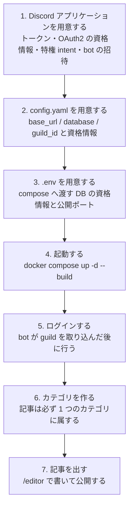

# instant-news

1 つの Discord サーバーに接続する、汎用のニュースプラットフォームです。

## 概要

instant-news は、1 つの Discord サーバー(guild)に接続して動く汎用のニュースプラットフォームです。1 デプロイが 1 つの guild に対応し、そのサーバーのメンバーとロールが、そのままユーザー管理・閲覧権限・報道社への所属の基盤になります。独自のパスワードやアカウント管理は持たず、認証は Discord OAuth2 に委ねます。

位置づけは汎用ブログではなくニュースです。記事は単一のカテゴリ(欄)に属し、報道社の署名を持ち、速報として出せて、訂正は訂正として記録されます。誰がいつ何を報じたかが一次情報として残ることと、公開してから読者に届くまでが速いことを設計の拠り所とし、記事の蓄積そのものよりも、鮮度と出所の明示を優先します。

記者は GitHub Flavored Markdown に近い記法で記事を書きます。公開すると server が通知の宛先を解決して待ち行列に積み、bot がその行を拾って該当チャンネルへ新着記事の embed を送り、コメント用のスレッドを開き、投票用の `:arrow_up:` / `:arrow_down:` を付けます。読者はその 2 つで賛否を投じ、スレッドへコメントします。賛否とコメントは bot が写し、記事面に点数とコメント欄として並び、報道社ランキングの材料になります。**書く場所は Discord だけです**(サイト側はコメントの投稿も投票も受け付けません)。閲覧範囲は Discord ロールで制御でき、本文中の画像はプラットフォームが自前で取り込んで保存します。フロントエンドはビルド工程を持たない素の HTML / JavaScript / CSS で構成し、server から静的配信します。アプリケーション全体は Docker 上で実行します。

## 主な機能

- GitHub Flavored Markdown に近い記法で記事を作成・編集・公開できる。下書き・レビュー・予約公開・公開・アーカイブの状態を持ち、予約公開は server が時刻の到来を判定して自動で公開する(bot が落ちていても公開は進む)。
- Discord OAuth2 によるログインを提供し、ユーザー管理を Discord アカウントに一元化する(独自のパスワードを保持しない)。
- **カテゴリ(単一必須)** が記事の主分類。記事は必ず 1 つのカテゴリ(欄)に属し、「この記事は何欄の記事か」が一意に定まる。カテゴリは新着通知の主たる宛先も担う。
- **タグ**は複数付けられる補助の分類軸で、通知の追加の宛先になる。**連載(マガジン)** は順序を持つ記事のまとまりを表す軸として、カテゴリ・タグとは独立に併存する。
- **報道社**。記事には報道社の署名を付けられ、所属は Discord のロールで表す。そのロールを保有する記者だけがその報道社の名義で記事を出せる。署名は公開の時点で凍結するため、記者が移籍しても過去記事の署名は遡って書き換わらない。解散した報道社の過去記事も残る。
- **報道社ランキング**。直近の一定期間(既定は 7 日)に公開された記事について、賛否とコメント数を報道社ごとに集計する。**反対票が点数を引くことはなく**、賛成に対して十分小さければ関心の証として半分だけ加え、賛成に迫るほど付いていればその記事の注目を実績として数えない(判定は記事ごと。規則は [docs/api.md](docs/api.md) を参照)。閲覧制限のある記事は公開のランキングに混ぜない。記事広告は開示されている以上、読者はそれを踏まえて反応しているため集計に含める。
- **速報**。設定で許可したロールの保有者だけが速報フラグを立てられ、通知時に設定したロールを mention する。許可ロールが空なら誰も立てられない。
- **訂正の明示**。改版履歴の各版は「単なる更新」と「訂正」を区別して記録し、訂正のあった記事は記事面で明示する。
- **広告**。画像広告を枠ごとに重み付き抽選で配信し、表示回数とクリック数を日次で集計する。記事広告(タイアップ記事)は「広告」の表示とスポンサー名をプラットフォーム側が描画し、記事面でも Discord の embed でも消せない。広告主・課金・入稿 UI は外部アプリケーションの担当で、コアは配信と計測に徹する。
- **画像の取り込み**。本文中の画像 URL を保存のたびに取得し、デコードして WebP へ再エンコードしたうえで自前で保存する。外部ホストに記事の見え方を依存させない(Discord の CDN URL は約 24 時間で失効するため、公開時まで待つと下書きのまま置かれた記事は失効後の取得になる)。取得は SSRF 対策を施し、取り込みに失敗した URL は執筆者に必ず伝える。
- **API キー**。機械クライアントが記事の自動投稿やプラットフォーム管理を行うための資格情報。キーは必ず人間のユーザーに紐づき、責任の所在が人間に残る。権限は発行時に凍結せず、要求のたびに現在のロールから判定する(管理者を外れたユーザーのキーはその時点で通らなくなる)。
- **プラットフォームの設定と分類を管理者がフロントエンドから管理できる**。Discord の連携・管理ロール・速報の権限・画像の取り込みの上限といった設定は MySQL に置き、管理者は `/admin` の画面から変更する。設定ファイルの書き換えとコンテナの再起動を要さない(bot のトークンのように、反映に再起動が要る設定だけが画面上でその旨を示す)。同じ画面のタブで、カテゴリ・タグ・報道社の作成・編集・削除も行える。ロールを指す設定(管理ロール・速報のロール)と報道社の所属ロールは、bot が取り込んだ Discord のロールから名前で選べる。設定の値域(上限・下限)は入力欄の制約として反映され、保存を押す前に分かる。
- 記事の編集履歴(改版)を保持し、過去版の参照と差分表示を可能にする。誰の名義で書かれたか(著者)と、誰が実際に投稿したか(API キー)を別々に記録する。
- 記事の閲覧範囲を Discord ロールで制御する(後述)。
- コメントは専用機能を持たず、bot が通知メッセージごとに開く Discord スレッドに委譲する。
- タグを購読すると、そのタグの記事が公開されたときに bot が DM で知らせる。チャンネルを持たない小さなタグでも成立する。
- 日本語を含む全文検索(MySQL の ngram パーサによる)。
- フロントエンドはビルド不要の素の HTML / JavaScript / CSS で構成し、FastAPI から静的配信する。

## アーキテクチャ

```mermaid
flowchart LR
    user([利用者])
    discord([Discord])
    adapp([広告管理アプリ<br/>外部アプリケーション])

    subgraph app[instant-news]
        web["フロントエンド<br/>素の HTML / JS / CSS"]
        server["server<br/>FastAPI + Uvicorn"]
        bot["bot<br/>discord.py"]
        db[("MySQL")]
        blobs[("画像ボリューム<br/>内容アドレスの WebP")]
    end

    user -->|閲覧・投稿| web
    user -->|OAuth2 ログイン| discord
    web -->|REST API| server
    discord -->|認可コード / ロール情報| server
    adapp -->|"API キー ads:admin で入稿・実績取得"| server

    server -->|記事・公開・通知の待ち行列| db
    server -->|画像の取り込みと配信| blobs
    bot -->|未送信の行を拾い、結果を書き戻す| db
    bot -->|新着記事 URL を送信 / スレッド作成| discord
    discord -->|ゲートウェイイベント<br/>(ロール・メンバー・投票・コメント)| bot
```

利用者はブラウザ上の静的フロントエンドから記事を閲覧・投稿します。認証は Discord OAuth2 で行い、server が認可コードを受け取ってユーザーを識別するとともに、対象 guild でのロールを取得して閲覧権限の判定に用います。外部からの入口は Discord と利用者だけではありません。**広告を管理する外部アプリケーションが、`ads:admin` スコープの API キーで server の管理用 API を叩き、広告の入稿・停止・実績取得を行います**。広告主・掲載プラン・課金といった商流はその外部アプリケーションが持ち、コアは配信と計測だけを引き受けます。

**server と bot の間に直接のイベント送信はありません**。記事を公開するのは server で、server は通知の宛先を解決して DB の待ち行列(アウトボックス)に未送信の行を積むところまでを行います。bot はその行を定期的に拾って Discord へ embed を送り、スレッドを開き、結果を書き戻します。server から bot へイベントを直接送る方式は、bot が落ちている間のイベントを取りこぼしますが、DB を待ち行列にすれば bot は復帰後に未送信の行を拾って送れます。

**Discord から bot へは、逆にイベントで届きます**。ロール・メンバー・オーナーの変更も、リアクションやスレッドの返信も、Discord 側で起きた出来事を知る手段はゲートウェイのイベントだけであり、bot はそれを購読して DB の写しを即座に追随させます。ロールを外せばその瞬間に権限が失効します。ゲートウェイのイベントも取りこぼしうる(bot の停止中の変更は届かず、処理に失敗したイベントは再送されない)ため、bot は新しいセッションを確立したときと一定の間隔ごとに、guild の現在の状態と写しを突き合わせて補正します。

記事の本文中の画像は server が取得して WebP へ再エンコードし、**画像ボリューム**に内容アドレス(変換後バイト列の SHA-256)で保存します。配信も server が行い、非公開の画像は参照元の記事の閲覧範囲に従って判定します。

## 閲覧範囲

記事の閲覧範囲は Discord ロールで制御します。全体公開(`public`)・サーバーメンバー限定(`members`)・特定ロール限定(`restricted`)の 3 段階を選べます。

これは汎用の権限機能である以上に、**全員には見せられない情報を扱えること**そのものが価値です。特定ロール限定の記事は、機密文書の公開、一部の読者に向けた限定ブリーフィング、報道社の社内限定の取材メモといった、公開を前提としない文書がそのまま成立します。読者の資格は既に Discord のロールが表しているため、招待コードやアカウント発行の仕組みを別に用意することなく、その場で範囲が定まります。報道社の所属自体がロールであるため、その報道社ロールを閲覧ロールに指定すれば社内限定記事になります。

範囲の判定には、それを裏切らないための約束がいくつかあります。

- 閲覧できない記事には **404 を返します**(403 は「そこに何かがある」ことを教えてしまうため)。
- 本文中の画像は記事と同じ判定を受けます。参照元の記事のいずれかを閲覧できる場合にのみ配信し、共有キャッシュには載せません。
- **カバー画像だけは認証なしで配信されます**。Discord の embed に出すために必要だからです。閲覧制限のある記事のカバーに、中身が分かる画像を選んではいけません。
- 記事ページの og メタ(タイトル・抜粋・画像)は、全体公開かつ公開済みの記事にだけ出します。

## 技術スタック

| 領域 | 採用技術 |
| --- | --- |
| バックエンド | FastAPI / Uvicorn(Python 3.12) |
| データベース | MySQL(aiomysql による非同期アクセス。ORM は使わない) |
| フロントエンド | 素の HTML / JavaScript / CSS(ビルド不要) |
| Markdown レンダリング | markdown-it-py(GFM 相当)+ nh3 によるサニタイズ |
| 画像処理 | Pillow(WebP への再エンコードと変種生成) |
| 認証・ユーザー管理 | Discord OAuth2 |
| Discord 連携 | discord.py による bot |
| 実行環境 | Docker |

Markdown のレンダリング結果は必ず nh3 でサニタイズします。本文は執筆者が書いた HTML を含みうるため、許可タグ・許可属性・許可 URL スキームを絞り込んだうえで出力します。

## ディレクトリ構成

```mermaid
flowchart TD
    root["instant-news/"]

    root --> common["common/ — server と bot が共有する層"]
    common --> common_config["config.py — config.yaml の読み込みと検証"]
    common --> common_settings["settings.py — 設定の登録簿・検証と settings 表の読み書き"]
    common --> common_db["db.py — aiomysql の薄いラッパ"]
    common --> common_sf["snowflake.py — スノーフレーク ID の正規化"]

    root --> server["server/ — FastAPI バックエンド"]
    server --> server_main["main.py — アプリケーションのエントリポイント"]
    server --> server_cli["cli.py — API キーの発行と設定の操作を行う CLI"]
    server --> server_req["requirements.txt"]
    server --> server_docker["Dockerfile"]
    server --> app["app/ — アプリケーション本体"]
    app --> app_auth["auth.py / principals.py / deps.py — 認証・認可"]
    app --> app_vis["visibility.py — 閲覧範囲の判定"]
    app --> app_md["markdown.py — GFM のレンダリングと画像 URL の抽出・差し替え"]
    app --> app_articles["articles.py — 記事の保存・公開・通知の待ち行列"]
    app --> app_rank["rankings.py — 報道社ランキングの集計"]
    app --> app_pages["pages.py — 静的 HTML の配信と og メタの注入"]
    app --> app_sched["scheduler.py — 予約公開のバックグラウンドループ"]
    app --> app_misc["errors.py / schemas.py — 例外の HTTP 変換 / pydantic モデル"]
    app --> app_media["media/ — 画像の取得・変換・保存・取り込み"]
    app --> app_routers["routers/ — HTTP エンドポイント"]
    server --> web["web/ — 静的フロントエンド(HTML/JS/CSS)"]
    web --> web_pages["index.html / article.html / tag.html / publisher.html / editor.html"]
    web --> web_settings["settings.html — 自分のアカウントと API キー"]
    web --> web_admin["admin.html — プラットフォームの設定(管理者向け)"]
    web --> web_assets["css/style.css, js/api.js, js/theme.js"]

    root --> bot["bot/ — Discord bot"]
    bot --> bot_main["main.py — bot のエントリポイント"]
    bot --> bot_req["requirements.txt"]
    bot --> bot_docker["Dockerfile"]
    bot --> bot_app["app/"]
    bot_app --> bot_client["client.py — ゲートウェイイベントの受け口と常駐タスク"]
    bot_app --> bot_votes["votes.py — 投票に使う絵文字の判定"]
    bot_app --> bot_comments["comments.py — コメント(スレッドの返信)の写し"]
    bot_app --> bot_delivery["delivery.py — 通知・DM の送信ループ"]
    bot_app --> bot_embeds["embeds.py — 記事の embed"]
    bot_app --> bot_role["roles.py — ロール・メンバー・オーナーの写し(イベント+照合)"]
    bot_app --> bot_react["counts.py — 投票の数の写し(イベント+照合)"]

    root --> migrations["migrations/ — DB スキーママイグレーション"]
    migrations --> mig0001["0001_initial.sql — 初期スキーマ"]

    root --> docs["docs/ — 設計ドキュメント"]
    docs --> docs_dm["data-model.md — データモデル(DB スキーマ)設計"]
    docs --> docs_api["api.md — HTTP API とキーの資格・スコープ"]
    docs --> docs_settings["settings.md — 設定の全キーと config.yaml / settings 表の役割分担"]
    docs --> docs_media["media.md — 画像の取り込み・変換・配信"]

    root --> conf["config.example.yaml — 設定ファイルのひな形"]
    root --> compose["docker-compose.yml — server / bot / MySQL の構成"]
```



## 設定

**`config.yaml` が持つのは、`server`・`database`・画像の保存先の 3 つだけです。**残りの設定の真実は MySQL の `settings` 表にあり、管理者はフロントエンドの `/admin` から変更します。

`config.example.yaml` を `config.yaml` としてコピーし、各値を実行環境に合わせて設定してください(`config.yaml` は Git 追跡対象外です)。設定ファイルの探索順は、明示した引数 → 環境変数 `INSTANT_NEWS_CONFIG` → リポジトリルートの `config.yaml` です。Discord のスノーフレーク ID は 64bit で JavaScript の数値精度を超えるため、設定ファイルでも API でも文字列として扱います。

| 出どころ | 対象 | 変更の手段 |
| --- | --- | --- |
| `config.yaml` | `server`(待ち受けるホストとポート、記事 URL の生成に用いる公開 URL)・`database`(MySQL の接続情報)・`media.storage_dir`(画像の実体を置くディレクトリ) | ファイルを書き換えて再起動する |
| `settings` 表(MySQL) | Discord の連携(guild・OAuth2・bot)・管理ロール・速報・API キーのレート制限・画像の取り込みの上限 | フロントエンドの `/admin`(復旧手段として CLI) |

**`config.yaml` に残る 3 つには、それぞれ DB に置けない理由があります。**`server` と `database` は、設定を DB から読むために先に要る値です(DB へ繋ぐ前に DB の接続情報は読めません)。`media.storage_dir` は**名前付きボリュームのマウント先と一体であり、コンテナの外で決まります**。マウントを変えずにこの値だけを変えても画像は見つからず、変えた瞬間に既存の全画像が参照できなくなるため、画面から触らせる意味がありません。

**`config.yaml` に書く残りの値は、初回起動時に `settings` 表へ写す初期値でしかありません。**値として効くのは初回だけであり、2 回目以降の起動でこれらを書き換えても何も起きません。投入は未登録のキーだけを埋める形で行い、既にある値は上書きしません。起動のたびに設定ファイルが DB を上書きする方式にすると、画面から変更した値が次の再起動で黙って元へ戻り、「設定したはずの値が効いていない」という最も原因を追いにくい壊れ方になります。どちらが真実かは一方に決める必要があり、**DB を真実としています**。

**初期値の節は任意です。**書かなかったキーは既定値で埋まるため、`config.yaml` に書く必要があるのは、その環境でしか決まらず既定を持てない値(`discord.guild_id` と OAuth2・bot の資格情報)だけです。投入が済んだ後に初期値の節を削除しても構いません。任意にしているのは、必須にすると設定を 1 つ増やすたびに既存のデプロイが `config.yaml` を編集するまで起動しなくなるうえ、「初回起動時の初期値でしかない」という説明と実際の挙動が食い違うためです。

- **`discord.guild_id` は画面に表示しますが変更できません**。変更すると、ロールのスナップショット・報道社のロール紐付け・閲覧範囲の判定がすべて別の guild を指し、既存のデータが無意味になります。他の guild へ移すのは再デプロイであって設定変更ではありません。
- **bot のトークンと OAuth2 のクライアントシークレットは、設定 API が生値を返しません**。設定済みかどうかだけを返します。返した時点で、画面を開ける者すべてに bot のトークンが渡ることになるためです。
- **設定を誤って画面から締め出した場合(`admin.role_ids` の設定ミスなど)は CLI から復旧できます**。CLI が `config.yaml` に求めるのは `database` 節だけです。復旧の最後の手段が、初期値の節が最新であることを前提にしてはならないためです。

各キーの一覧(型・変更可否・再起動の要否・説明)と CLI の使い方は [docs/settings.md](docs/settings.md) にあります。

いくつかの点は、設定にあってしかるべきものが無い / 無くてしかるべきものが無い、という形で意図的です。

- **既定の通知先チャンネルはありません**。通知の宛先は記事のカテゴリとタグの通知先チャンネルを重複排除した集合として解決し、宛先が 0 件の記事はどこにも通知しません。既定チャンネルへ落とすと「この欄は通知しない」という意図を表現できなくなります。
- **`admin.role_ids` は Discord の Administrator 権限を配らずに済ませるためにあります**。既定では Administrator 権限の保有者と guild オーナーが管理者に該当しますが、Administrator はサーバーの全操作を許す極めて強い権限であり、広告を入稿させたいだけの相手に与えるのは筋が悪いためです。ここに「編集長」「広告担当」といったロールを列挙すれば、Administrator なしでプラットフォーム管理を委譲できます。guild オーナーは bot がイベント(オーナーの移譲)と照合で取り込むため、設定には現れません。
- **カテゴリ・タグ・報道社・広告は設定ではありません**。設定ファイルにも `settings` 表にも現れず、それぞれ専用のテーブルを持つ実体として、`taxonomy:admin` / `ads:admin` スコープの管理用 API で編集します。記事のカテゴリは外部キーで参照する実体であり、値として持つと参照整合性を保てないためです。カテゴリ集合はデプロイごとに異なるため、コアは固定の集合を持ちません。
- **API キーは設定に現れません**。キーは Web UI と CLI から発行し、生値は保存せず SHA-256 のみを保持します。設定ファイルにキーを書く方式は、生値がファイルに残る点でこの方針と矛盾します。

## 実行

アプリケーションは Docker 上で実行します。server(FastAPI)・bot(Discord bot)・MySQL の各サービスをコンテナとして起動し、`migrations/` の SQL でスキーマを初期化する構成です。

### 前提

- Docker と Docker Compose(`docker compose`)。
- 対象とする Discord サーバー(guild)と、そこへ bot を招待できる権限。1 デプロイが 1 つの guild に対応します。
- Discord の開発者ポータルでアプリケーションを作成できること。

ホスト側に Python は要りません。server も bot も CLI もコンテナの中で動きます。



### 1. Discord アプリケーションを用意する

[Discord 開発者ポータル](https://discord.com/developers/applications) で次を行います。

1. アプリケーションを作成する。
2. **Bot** タブでトークンを発行して控える(`discord.bot.token`)。トークンは発行の直後にしか表示されません。
3. 同じ **Bot** タブで特権 intent を 2 つとも有効にする。**SERVER MEMBERS INTENT**(guild のメンバーの取り込みと、参加・離脱・ロール変更のイベントの購読に要る)と **MESSAGE CONTENT INTENT**(記事のコメントの本文の取得に要る)です。どちらかでも欠けると Discord がゲートウェイを切り、bot は起動時に停止します。
4. **OAuth2** タブで `client_id` と `client_secret` を控える。
5. 同じ **OAuth2** タブの **Redirects** に、`server.base_url` へ `/auth/callback` を足した URL を登録する(既定の `http://localhost:8000` なら `http://localhost:8000/auth/callback`)。戻り先の URL は設定として持たず `base_url` から導出するため、ここに登録する値と `base_url` は必ず一致していなければなりません。食い違うと、認可の結果を受け取る経路が無い場所へ Discord が戻すため、ログインだけが静かに壊れます。
6. bot を対象の guild へ招待する(scope は `bot`)。利用者のログインに要る OAuth2 のスコープは `identify` と `guilds.members.read` で、これらは server が認可 URL を組み立てる際に自ら要求するため、ポータル上での設定は要りません。

bot に与える権限は、通知先のチャンネルで行う操作から決まります。

| 操作 | 要る権限 |
| --- | --- |
| 新着記事の embed を送る | View Channel / Send Messages / Embed Links |
| 投票用の `:arrow_up:` / `:arrow_down:` を付ける | Add Reactions |
| コメント用のスレッドを開く | Create Public Threads / Send Messages in Threads |
| 投票とコメントを照合し直す | Read Message History |

guild の ID(`discord.guild_id`)は、Discord の詳細設定で開発者モードを有効にし、サーバー名を右クリックして「サーバー ID をコピー」で得られます。

### 2. config.yaml を用意する

```bash
cp config.example.yaml config.yaml
```

`config.yaml` は Git 追跡対象外であり、イメージにも焼き込まず実行時にマウントで渡します。設定を変えてもイメージの再ビルドは要りません。

その環境でしか決まらず、既定を持てない値は次のとおりです。残りは既定値のままで動きます。

| キー | 内容 |
| --- | --- |
| `server.base_url` | 利用者のブラウザから見えるオリジン。記事 URL・画像の絶対 URL・OAuth2 の戻り先の組み立てに用いる。逆プロキシを挟む構成では、待ち受け先の `server.host` / `server.port` ではなく外から見える URL を書く。 |
| `database.password` | MySQL のパスワード。`.env` の `MYSQL_PASSWORD` と一致させる。 |
| `discord.guild_id` | 対象の guild の ID。 |
| `discord.oauth.client_id` / `discord.oauth.client_secret` | OAuth2 の資格情報。 |
| `discord.bot.token` | bot のトークン。 |

`database.host` は compose のサービス名である `db` のままにします。`media.storage_dir` は名前付きボリュームのマウント先と一体であるため、`docker-compose.yml` の `media-data` のマウント先と揃えて変えない限り触りません。

`discord` 以下・`admin`・`articles`・`media.fetch` は初期値の節であり、効くのは初回起動時だけです(後述の「設定を変える」を参照)。

### 3. .env を用意する

```bash
cp .env.example .env
```

compose は YAML の設定ファイルを読めないため、DB の資格情報と公開ポートだけが `config.yaml` と二重に現れます。`.env` の各値は `config.yaml` の対応する値と一致させてください。`db` は `.env` の値で MySQL の利用者とデータベースを作り、`server` と `bot` は `config.yaml` の値で繋ぎにいくため、食い違うと `server` は起動した MySQL へ繋げません。

| キー | 内容 |
| --- | --- |
| `MYSQL_DATABASE` | MySQL のデータベース名。`config.yaml` の `database.name` と一致させる。 |
| `MYSQL_USER` | アプリケーションが使う MySQL の利用者。`config.yaml` の `database.user` と一致させる。 |
| `MYSQL_PASSWORD` | 上記の利用者のパスワード。`config.yaml` の `database.password` と一致させる。 |
| `MYSQL_ROOT_PASSWORD` | MySQL の root のパスワード。アプリケーションは root を使わず、保守用に設けるもので、`MYSQL_USER` とは別である。`config.yaml` に対応する値は無い。 |
| `INSTANT_NEWS_PORT` | `server` を公開するポート。`config.yaml` の `server.port` と一致させる。コンテナの内と外で同じ番号を使うため、変える場合は両方を合わせる。 |

`MYSQL_PASSWORD` と `MYSQL_ROOT_PASSWORD` に既定値はなく、`.env.example` でも空です。未設定・空のままなら compose が起動を拒みます。ひな形に既定の資格情報を書くと、変更されないまま本番へ出るためです。`.env` は `config.yaml` と同じく Git 追跡対象外です(ひな形の `.env.example` は追跡対象のため、実際の資格情報を書かないでください)。

### 4. 起動する

```bash
docker compose up -d --build
```

初回は db がスキーマを初期化するまで server と bot が待ちます。`migrations/` の SQL は**データディレクトリが空のとき、すなわち初回起動時にしか実行されません**。既存のデータがある環境でスキーマを変える手段にはなりません。

```bash
docker compose ps
docker compose logs -f server bot
```

bot が「対象の guild ... として起動します」と出せば Discord へ繋がっており、server の healthcheck が healthy になればトップページが配信できています。

### 5. ログインする

ブラウザで `server.base_url` を開き、Discord でログインします。ユーザーの行はこのときに作られます。

**bot が guild を取り込む前にログインした場合、ロールが 1 つも写らず管理者と判定されません**。ロールの写しを書くのは bot であり、ログインの経路は bot が取り込み済みのロールしかユーザーへ結びつけません。guild のオーナーであるかどうかも、guild 自体を読める bot だけが知りうる情報です。bot の起動を確かめたうえで、ログインし直してください。

管理者に該当するのは、guild のオーナー、Administrator 権限を持つロールの保有者、`admin.role_ids` に列挙したロールの保有者です。

### 6. カテゴリを作る

**記事は必ず 1 つのカテゴリに属するため、カテゴリが 1 つも無いと記事を作れません**。カテゴリ・タグ・報道社は設定ではなく専用のテーブルを持つ実体です。**管理者は `/admin` の画面から、設定と同じ場所でこれらを作成・編集・削除できます**(設定タブの隣にカテゴリ・タグ・報道社のタブがあります)。ブラウザだけでデプロイを立ち上げられるよう、最初の 1 つを作るのに API キーも curl も要りません。

`/admin` を開き、「カテゴリ」タブで slug(URL に使う識別子)と表示名を入れて作成します。通知先チャンネルの ID を入れると、その欄の記事がそのチャンネルへ流れます(省くとどこにも通知しません。既定の通知先チャンネルは無く、宛先は記事のカテゴリとタグの通知先を重複排除した集合として解決します)。タグと報道社も同じ画面の各タブで作ります。報道社の所属ロールと、設定のロール(管理ロール・速報のロール)は、bot が取り込んだ Discord のロールから名前で選べます。

機械のクライアントから同じ操作を行う場合は、`taxonomy:admin` スコープの管理用 API を使います。`/settings` で同スコープの API キーを発行し(管理者だけが発行できます。CLI からも発行できます)、次のように投入します。

```bash
docker compose exec server python -m server.cli issue-token --discord-user-id 000000000000000000 --name "初期設定" --scope taxonomy:admin
```

```bash
export API_KEY=発行したキー
curl -X POST "http://localhost:8000/api/admin/categories" \
  -H "Authorization: Bearer $API_KEY" \
  -H 'Content-Type: application/json' \
  -d '{"slug":"world","name":"国際","notify_channel_id":"000000000000000000"}'
```

`--discord-user-id` には自分の Discord ユーザー ID を渡します。生のキーは DB に保存しない(SHA-256 だけを持つ)ため、表示は 1 度きりです。タグ(`/api/admin/tags`)と報道社(`/api/admin/publishers`)も同じ要領で作れます。各エンドポイントの詳細は [docs/api.md](docs/api.md) にあります。

### 7. 記事を出す

`/editor` で記事を書いて公開すると、server が通知の宛先を解決して待ち行列へ積み、bot がその行を拾って該当チャンネルへ embed を送り、コメント用のスレッドを開き、投票用の `:arrow_up:` / `:arrow_down:` を付けます。読者はその 2 つで賛否を投じ、スレッドへコメントします。

### 設定を変える

`config.yaml` の `server`・`database`・`media.storage_dir` を変える場合は、ファイルを書き換えて再起動します。

```bash
docker compose up -d
```

**それ以外の設定は `config.yaml` を書き換えても何も起きません**。真実は `settings` 表にあり、`config.yaml` のそれらの値は初回起動時に未登録のキーだけを埋める初期値でしかないためです。管理者は `/admin` の画面から変更します。server と bot は `settings` 表を定期的に読み直すため、変更した本人以外への反映には最大 10 秒かかります。bot のトークンのように再起動を要する設定は、画面がその旨を示します。

管理ロールの設定を誤って画面から締め出された場合は、CLI が唯一の復旧手段です。

```bash
docker compose exec server python -m server.cli list-settings
docker compose exec server python -m server.cli set-setting admin.role_ids '["000000000000000000"]'
```

### 更新する

```bash
docker compose up -d --build
```

イメージを入れ替えても、DB と画像の実体は名前付きボリュームに残ります。**ただし `migrations/` の SQL は再実行されません**(初回起動時にしか走りません)。スキーマの変更を含む更新では、追加分の SQL を自分で適用してください。

### 状態と永続化

server・bot・MySQL のコンテナに加えて、**画像の実体を置く名前付きボリュームが要ります**。画像は外部ホストに依存せず自前で保存するため、`media.storage_dir` にはコンテナのファイルシステムではなく Docker の名前付きボリュームを割り当ててください(`docker-compose.yml` の `media-data` が既にそう構成しています)。コンテナのファイルシステムに置くと、イメージを入れ替えた瞬間に全画像が消えます。

このため、**状態を持つ場所は MySQL だけではありません**。DB は画像の登録簿(ハッシュ・寸法・公開可否・参照元の記事)を持ち、画像の実体はボリュームにあります。片方だけでは記事は復元されません。DB だけを復旧すると、記事の行は戻るのに本文が指す画像が 404 になります。ボリュームだけを復旧すると、実体はあるのにそれを参照する記事が存在しません。**バックアップは DB と画像ボリュームを整合した時点で取り、両者を組にして戻してください**。時点がずれた場合、DB が新しければ実体の無い画像を参照し、ボリュームが新しければ誰からも参照されない実体が残ります(後者は無害ですが、前者は記事が壊れます)。

`docker compose down` はコンテナを破棄しますがボリュームは残します。`docker compose down -v` は**記事も画像もすべて消します**。

### 困ったとき

| 症状 | 原因と対処 |
| --- | --- |
| bot が特権 intent の不足で停止する | 開発者ポータルで SERVER MEMBERS INTENT と MESSAGE CONTENT INTENT を有効にする。有効にせずに要求すると Discord がゲートウェイを切る。 |
| ログインが Discord 側で弾かれる | ポータルの Redirects と `server.base_url` から導出される `/auth/callback` が一致していない。 |
| ログインできるが管理者にならない | bot が guild を取り込む前にログインした。bot の起動を確かめてログインし直す。 |
| 記事を公開したのに通知が来ない | カテゴリにもタグにも `notify_channel_id` が無い(宛先 0 件の記事はどこにも通知しない)か、bot にそのチャンネルの権限が無い。 |
| 画面から設定を変えたのに効かない | 別のプロセス(server と bot)への反映まで最大 10 秒かかる。再起動を要する設定は画面がその旨を示す。 |
| `config.yaml` を書き換えたのに効かない | 初期値の節は初回起動時にしか読まれない。`/admin` か CLI から変更する。 |
| 管理画面にも設定 API にも入れない | CLI の `set-setting` で `admin.role_ids` を直す(唯一の復旧手段)。 |

## ドキュメント

設計・仕様に関する詳細ドキュメントは `docs/` 配下に配置します。

| ドキュメント | 内容 |
| --- | --- |
| [docs/data-model.md](docs/data-model.md) | データモデル(DB スキーマ)の設計。テーブルの責務、記事の状態遷移、閲覧範囲、Discord との対応関係、通知の待ち行列。 |
| [docs/api.md](docs/api.md) | HTTP API のエンドポイント一覧と表現の規約。API キーの発行資格とスコープ、署名の凍結と権限の都度判定、監査証跡、レート制限。 |
| [docs/settings.md](docs/settings.md) | 設定の全キー(型・変更可否・再起動の要否)。`config.yaml` と `settings` 表の役割分担、初期値の投入が初回だけである理由、秘密を API から返さない理由、CLI による復旧手段。 |
| [docs/media.md](docs/media.md) | 画像の取り込み・変換・配信。SSRF 対策、WebP への再エンコード、内容アドレスでの保存、配信時の閲覧範囲の判定。 |
