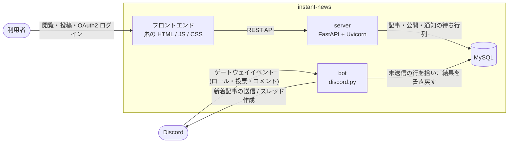

# instant-news

1 つの Discord サーバー(guild)に接続して動く、汎用のニュースプラットフォームです。

## 概要

1 デプロイが 1 つの guild に対応し、そのサーバーのメンバーとロールがそのままユーザー管理・閲覧権限・報道社への所属の基盤になります。独自のパスワードやアカウント管理は持たず、認証は Discord OAuth2 に委ねます。

位置づけは汎用ブログではなくニュースです。記事は単一のカテゴリに属し、報道社の署名を持ち、速報として出せて、訂正は訂正として記録されます。記者は GitHub Flavored Markdown に近い記法で記事を書き、公開すると bot が該当 Discord チャンネルへ embed を送り、コメント用のスレッドを開き、投票用のリアクションを付けます。**書く場所は Discord だけです**(サイト側はコメントの投稿も投票も受け付けません)。フロントエンドはビルド工程を持たない素の HTML / JavaScript / CSS で、アプリケーション全体は Docker 上で実行します。



server と bot の間に直接のイベント送信はありません。server は通知の宛先を解決して DB の待ち行列に積むところまでを行い、bot がそれを拾って Discord へ送ります。Discord からは逆にゲートウェイイベントで bot へ届き、bot が DB の写しを追随させます。

## 主な機能

- GFM に近い記法での記事作成・編集・公開(下書き・レビュー・予約公開・公開・アーカイブ)
- Discord OAuth2 によるログイン(独自のパスワードを持たない)
- カテゴリ(単一必須)・タグ(複数可)・連載(マガジン)による分類
- 報道社(Discord ロールで所属を表現し、署名は公開時点で凍結)
- 報道社ランキング(直近期間の賛否・コメント数を集計)
- 速報(許可ロールの保有者のみがロールを mention して発報)
- 訂正の明示(改版履歴で「更新」と「訂正」を区別)
- 広告配信(画像広告の重み付き抽選、記事広告の開示表示)
- 本文中の画像の取り込み(WebP への再エンコードと自前保存、SSRF 対策)
- API キーによる自動投稿・管理(人間のユーザーに紐づき、権限は要求のたびに判定)
- 管理者がフロントエンド(`/admin`)から設定・カテゴリ・タグ・報道社を管理
- 記事の編集履歴(改版)と Discord ロールによる閲覧範囲の制御
- 日本語を含む全文検索(MySQL の ngram パーサ)

各機能の詳細な仕様は `docs/` 配下のドキュメントを参照してください。

## 技術スタック

| 領域 | 採用技術 |
| --- | --- |
| バックエンド | FastAPI / Uvicorn(Python 3.12) |
| データベース | MySQL(aiomysql による非同期アクセス。ORM は使わない) |
| フロントエンド | 素の HTML / JavaScript / CSS(ビルド不要) |
| Markdown レンダリング | markdown-it-py(GFM 相当)+ nh3 によるサニタイズ |
| 画像処理 | Pillow(WebP への再エンコードと変種生成) |
| 認証・ユーザー管理 | Discord OAuth2 |
| Discord 連携 | discord.py による bot |
| 実行環境 | Docker |

## セットアップ

### 前提

- Docker と Docker Compose(`docker compose`)。ホスト側に Python は不要です(server も bot も CLI もコンテナの中で動きます)。
- 対象とする Discord サーバー(guild)と、そこへ bot を招待できる権限。1 デプロイが 1 つの guild に対応します。
- [Discord 開発者ポータル](https://discord.com/developers/applications)でアプリケーションを作成できること。

### 1. Discord アプリケーションを用意する

1. アプリケーションを作成する。
2. **Bot** タブでトークンを発行して控える(発行の直後にしか表示されません)。
3. 同じ **Bot** タブで **SERVER MEMBERS INTENT** と **MESSAGE CONTENT INTENT** を両方とも有効にする(どちらかでも欠けると bot は起動時に停止します)。
4. **OAuth2** タブで `client_id` と `client_secret` を控える。
5. 同タブの **Redirects** に、`server.base_url` へ `/auth/callback` を足した URL を登録する(既定なら `http://localhost:8000/auth/callback`)。
6. bot を対象の guild へ招待する(scope は `bot`)。

bot には通知先チャンネルで新着記事の embed 送信・リアクション付与・スレッド作成・履歴読み取りができる権限(View Channel / Send Messages / Embed Links / Add Reactions / Create Public Threads / Send Messages in Threads / Read Message History)を与えてください。guild の ID は、開発者モードを有効にしたうえでサーバー名を右クリックし「サーバー ID をコピー」で得られます。

### 2. config.yaml を用意する

```bash
cp config.example.yaml config.yaml
```

その環境でしか決まらない値だけを埋めます(残りは既定値で動きます)。

| キー | 内容 |
| --- | --- |
| `server.base_url` | 利用者のブラウザから見えるオリジン。 |
| `database.password` | MySQL のパスワード(`.env` の `MYSQL_PASSWORD` と一致させる)。 |
| `discord.guild_id` | 対象の guild の ID。 |
| `discord.oauth.client_id` / `discord.oauth.client_secret` | OAuth2 の資格情報。 |
| `discord.bot.token` | bot のトークン。 |

`config.yaml` は Git 追跡対象外です。設定の全体像(何が `config.yaml` に残り何が `/admin` から変えられるか)は [docs/settings.md](docs/settings.md) を参照してください。

### 3. .env を用意する

```bash
cp .env.example .env
```

`MYSQL_DATABASE` / `MYSQL_USER` / `MYSQL_PASSWORD` を `config.yaml` の `database` と一致させ、`MYSQL_ROOT_PASSWORD` を設定します。`MYSQL_PASSWORD` と `MYSQL_ROOT_PASSWORD` に既定値はなく、未設定のままだと compose が起動を拒みます。

### 4. 起動する

```bash
docker compose up -d --build
docker compose logs -f server bot
```

bot が guild を取り込んだこと、server の healthcheck が healthy になったことを確認してください。`migrations/` の SQL はデータディレクトリが空のとき(初回起動時)にしか実行されません。

### 5. ログインしてカテゴリを作る

`server.base_url` をブラウザで開き Discord でログインします。**bot が guild を取り込む前にログインするとロールが写らず管理者と判定されない**ため、bot の起動を確認してからログインしてください。管理者(guild オーナー・Administrator 権限保有者・`admin.role_ids` のロール保有者)は `/admin` を開き、「カテゴリ」タブで最初のカテゴリを作成します(記事は必ず 1 つのカテゴリに属するため、カテゴリが 1 つも無いと記事を作れません)。タグ・報道社も同じ画面の各タブで作れます。

### 6. 記事を出す

`/editor` で記事を書いて公開すると、server が通知の宛先を解決して待ち行列へ積み、bot が該当チャンネルへ embed を送り、コメント用のスレッドを開き、投票用のリアクションを付けます。

### 更新する

```bash
docker compose up -d --build
```

DB と画像の実体は名前付きボリュームに残ります。ただし `migrations/` の SQL は再実行されないため、スキーマ変更を含む更新では追加分の SQL を自分で適用してください。`docker compose down -v` は記事・画像を含めすべて消すため注意してください。

## テスト

統合テストは、本番の構成とは独立したテスト用のコンテナで実行します。使い捨ての MySQL(データは tmpfs 上にあり、起動のたびに `migrations/` から作り直します)と pytest の実行コンテナからなり、ポートを公開せず `.env` も読まないため、稼働中のデプロイと並べて動かせます。

```bash
docker compose -f docker-compose.test.yml run --rm --build tests
docker compose -f docker-compose.test.yml down -v
```

1 行目の終了コードが pytest の結果です。テストは `tests/` にあり、設定は `tests/config.test.yaml` を使います。

## ドキュメント

| ドキュメント | 内容 |
| --- | --- |
| [docs/data-model.md](docs/data-model.md) | データモデル(DB スキーマ)の設計。テーブルの責務、記事の状態遷移、閲覧範囲、Discord との対応関係、通知の待ち行列。 |
| [docs/api.md](docs/api.md) | HTTP API のエンドポイント一覧と表現の規約。API キーの発行資格とスコープ、署名の凍結と権限の都度判定、監査証跡、レート制限。 |
| [docs/settings.md](docs/settings.md) | 設定の全キー(型・変更可否・再起動の要否)。`config.yaml` と `settings` 表の役割分担、CLI による復旧手段。 |
| [docs/media.md](docs/media.md) | 画像の取り込み・変換・配信。SSRF 対策、WebP への再エンコード、内容アドレスでの保存、配信時の閲覧範囲の判定。 |
| [docs/frontend.md](docs/frontend.md) | 画面の構成と幅への対応。ビルドを持たない理由、3 つの層、幅の 3 層とスマホでのナビ・検索・エディタの組み替え。 |
