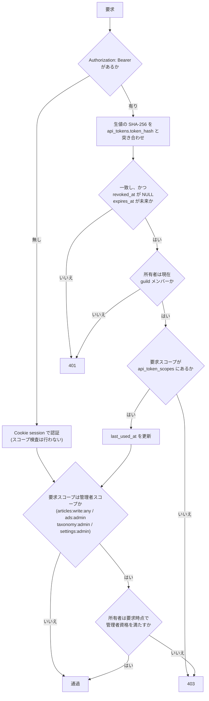
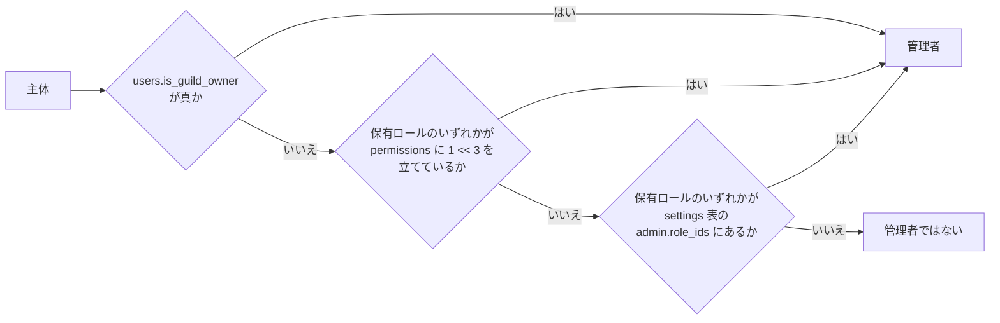

# HTTP API

本書は instant-news の HTTP API を説明する。中心の主題は 2 つある。**API キーの発行資格とスコープ**(誰がどのキーを発行でき、そのキーで何ができるか)と、**自動投稿および管理用エンドポイント**の仕様である。実体は `server/app/principals.py`(認証主体と権限判定)・`server/app/deps.py`(依存性)・`server/app/routers/` 配下(各エンドポイント)・`server/cli.py`(キー発行 CLI)にあり、本書とこれらは常に一致させる。

## 表現の規約

- **JSON 応答に含まれる ID は、すべて文字列である。**DB の `BIGINT UNSIGNED` の ID も Discord のスノーフレークも例外なく文字列で返す。JavaScript の `Number` は 2^53 までしか正確に表せず、スノーフレークは黙って壊れる(丸められた ID はエラーにならず、単に別の ID になる)。
- 日時は ISO 8601 の UTC(末尾 `Z` 付き)で返す。
- 認証の受け口は 2 つある。Cookie `session`(不透明トークン)と `Authorization: Bearer <api key>` である。両方が付いている要求では **Bearer を優先する**。
- API キーは `ink_` プレフィックスを付けて発行する。

## API キーの発行資格とスコープ

### 発行資格は 2 つある

**投稿者(記事を書けるユーザー)は `articles:write` を自己申請で発行できる。**管理者の承認を要しない。このキーは著者をキーの所有者に固定するため、**自分の名前でしか記事を書けない**。すなわち、このキーで得られる力は、その人が Web UI から手で投稿するのと変わらない。既に持っている権限を機械に貸すだけであり、承認を挟む理由がない。

**管理者は `articles:write:any` / `ads:admin` / `taxonomy:admin` / `settings:admin` を発行できる。**これらは自分の名義を超えて他者・プラットフォーム全体に影響する力であるため、発行資格を管理者に限る。

### 発行資格とスコープは別の軸である

「誰が発行できるか」(発行資格)と「何ができるか」(スコープ)は独立した軸として扱う。**管理者が発行できるスコープを 1 つに束ねてはならない。**

広告管理アプリに与えるのは `ads:admin` **だけ**である。`articles:write:any` は**他人の名前で記事を出せる権限**であり、記事と無関係のクライアントに混ぜて渡してはならない。広告の入稿を委託した相手のキーが漏れたとき、失うのが広告枠の制御だけなのか、それとも任意の記者の署名で偽の記事を出せる力なのかは、まったく別の事故である。スコープを束ねると、この差が消える。

| スコープ | 何ができるか | 発行資格 | 要求時に必要な資格 |
| --- | --- | --- | --- |
| `articles:write` | 記事の作成・更新。著者はキーの所有者に固定される。 | 所有者本人(自己申請) | 所有者が guild メンバーであること |
| `articles:write:any` | 著者・報道社を自由に指定した記事の作成・更新。 | 管理者のみ | 要求時点で所有者が管理者であること |
| `ads:admin` | 広告の登録・更新・停止・実績取得。 | 管理者のみ | 要求時点で所有者が管理者であること |
| `taxonomy:admin` | カテゴリ・タグ・報道社の管理。 | 管理者のみ | 要求時点で所有者が管理者であること |
| `settings:admin` | プラットフォームの設定の読み取りと変更。 | 管理者のみ | 要求時点で所有者が管理者であること |

**`settings:admin` は他のどのスコープよりも強い。**このスコープは管理ロール(`admin.role_ids`)を書き換えられる、すなわち**管理者の資格そのものを配れる**。任意のロールを管理ロールに加えれば、そのロールの保有者は管理者になり、以後は他のあらゆる管理スコープのキーを発行できる。他のスコープが「プラットフォームのある一面を操作する力」であるのに対し、これは「誰がプラットフォームを操作できるかを決める力」であり、実質的に管理者権限の委譲である。渡す相手はその前提で選ぶこと。

**したがって、設定を触らせたいだけの相手に他のスコープを混ぜない。**広告管理アプリに `ads:admin` だけを渡すのと同じ理由である。逆に、記事や広告を扱うクライアントに `settings:admin` を混ぜてはならない。そのキーが漏れたときに失うのは、そのクライアントが担っていた機能ではなく、プラットフォーム全体の統制である。

**`articles:write:any` は `articles:write` を含意する。**「著者・報道社を自由に指定した記事の作成・更新」は「著者を所有者に固定した記事の作成・更新」を包含するため、`articles:write:any` **だけ**を与えたキーで `POST /api/articles` / `PATCH /api/articles/{id}` / `POST /api/articles/{id}/publish` は成立する。2 つを併記する必要はない(スコープは 1 本のキーにつき 1 つだけ与えるのが原則である)。ただし含意で通した場合も、貸し出されている力は管理者スコープのものであるため、**要求の時点で所有者が管理者であることを検査する**。管理者でない所有者の `articles:write:any` キーは、記事の作成・更新も含めて 403 になる(`articles:write` 相当へ黙って降格させることはしない)。

## 署名は凍結し、権限は都度判定する

Discord のロールのスナップショット(`discord_roles` / `user_roles`)は 2 つの用途に使われ、**扱いが正反対である**。この非対称は意図的であり、どちらも逆にしてはならない。

- **署名(`articles.publisher_id`)は公開時に凍結する。**公開の時点で「著者がその報道社のロールを実際に持っているか」を検証し、以後ロールが変わっても動かさない。現在のロールから報道社を引く実装にすると、記者が移籍した瞬間に過去記事の署名が遡って書き換わる。誰がいつどの社の名前で報じたかは、過去の事実であって現在の所属の関数ではない。
  - **凍結とは、公開後は `publisher_id` も `author_id` も変更できないという意味である。**公開済みの記事に対してこれらを変える保存は、`articles:write:any` を持つ主体からのものであっても **403** になる。片方だけでも書き換えられると、公開時の検証を経ていない「著者と報道社の対」が検証済みの署名として記事に残る(先に公開してから報道社を後付けする、正当に公開した記事の著者だけを他人へ差し替える、という順序で検証を素通りできてしまう)。値の変わらない指定は素通しするため、公開済みの記事の本文・見出しの訂正は妨げない。
- **キーの権限は要求のたびに現在のロールから判定する。**発行時の資格を凍結してはならない。凍結すると、管理者を外れたユーザーが古いキーで管理権限を持ち続ける。権限剥奪がキーの棚卸しを伴わなければ完了しない設計は、遅かれ早かれ破れる。

キーにスコープが付いていることは、**そのスコープを使えることを意味しない**。管理者スコープは、要求の時点で所有者が現に管理者資格を満たしていなければ通らない。



セッション経由の主体はスコープを持たないため、**スコープ検査は API キー経由のときだけ行う**。セッションは Web UI の権限(自分の名義で書く / 管理者なら管理操作)をスコープ検査を経ずに持ち、管理者スコープに相当する操作のときのみ現在の管理者資格を検査する。

キーの照合が通っても、所有者が guild メンバーでなければ 401 を返す。要求スコープを今の資格が満たさなければ 403 を返す。

## 管理者の判定

管理者資格は次のいずれかを満たすことである。

- `users.is_guild_owner` が真であること(guild オーナー)。
- 保有ロールのいずれかが `discord_roles.permissions` に Administrator ビット(`1 << 3`)を立てていること。
- 保有ロールのいずれかが設定の `admin.role_ids` に含まれること。

既定(`admin.role_ids` が空)では、Discord の Administrator 権限保有者と guild オーナーだけが該当する。**`admin.role_ids` はそこからの逃げ道である。**Administrator はサーバーの全操作を許す極めて強い権限であり、広告を入稿させたいだけの相手に与えるのは筋が悪い。ここに管理ロールを列挙すれば、Administrator を配らずに「編集長」「広告担当」といったロールへプラットフォーム管理を委譲できる。委譲の粒度を Discord の権限体系に縛られずに決められることが要点である。

**`admin.role_ids` の出どころは `settings` 表であり、`config.yaml` ではない。**設定ファイルのこの値は初回起動時に `settings` 表へ写す初期値でしかなく、以後は参照されない。稼働中の値は `/admin` の画面(`PATCH /api/admin/settings`)か CLI から変更する。値の意味も、Administrator ビット・guild オーナーとの併用の仕方も、出どころが変わっただけで従前のままである。設定の全体像は [docs/settings.md](settings.md) を参照。

guild オーナーは bot がゲートウェイのイベント(オーナーの移譲)と照合で `users.is_guild_owner` として取り込むため、設定には現れない。



## 生キーの扱い

- 生のキーは**発行直後の応答で一度だけ表示し、以後は再表示しない**。`POST /api/me/tokens` の応答と `python -m server.cli issue-token` の標準出力が、生値の現れる唯一の場所である。
- DB には **SHA-256 のみを保存する**(`api_tokens.token_hash`)。生値は保持しない。漏洩時にキーを直接復元できないようにするためであり、セッション(`sessions`)と同じ設計を踏襲する。
- `api_tokens.token_prefix` に先頭 12 文字を**平文で**持ち、一覧でキーを判別できるようにする。これが無いと、複数のキーを持つユーザーは**どれを失効させればよいか分からなくなる**。「相場自動投稿」と「広告管理アプリ」の 2 本を持つ人が、漏れた 1 本だけを止めたいときに、名前と発行日時しか手掛かりがなければ、確信を持てないまま両方を失効させることになる。プレフィックスは秘密ではなく、識別のための公開された断片である。
- 秘密の比較には `hmac.compare_digest` を使う。

## 監査証跡

**`article_revisions.via_token_id` が「誰が実際に投稿したか」を記録する。**`article_revisions.editor_id` は「誰の名前で書かれたか」であって、**両者は別物である**。`articles:write:any` が他人の署名で記事を出せる以上、これが無いと説明責任が崩れる。ある記事が誰の名義かは分かるが、それを実際に押し込んだのがどのキーだったかを追う手段が消えるためである。Web UI からの編集では `via_token_id` は NULL になり、それ自体が「人間が直接書いた」という情報になる。

`media` も同じ構造を持つ。`uploaded_by`(取り込んだ人間)と `via_token_id`(経由したキー、Web UI からなら NULL)の両方を保持する。

## 自動投稿記事の署名表示

**`articles.author_id` は NOT NULL のまま維持し、責任の所在を必ず人間に残す。**機械が投稿した記事であっても、そのキーを発行した人間が責任を負う。キーは独自アカウントを増やすのではなく、既存ユーザーの権限を機械が借りる形にしてあり、借り手が誰であれ貸し手は人間である。

一方で、相場表のような記事に個人名が出るのは不自然である。この 2 つの要請は `byline_mode` で両立させる。

| `byline_mode` | 記事面の署名表示 | `author_id` |
| --- | --- | --- |
| `author`(既定) | 著者名を出す。 | 保持する。 |
| `publisher` | 報道社名のみを出す。個人名は出さない。 | 保持する(監査では追える)。 |

すなわち **`byline_mode='publisher'` は責任の所在と表示を分離する**。表示から個人名を消すことと、記録から個人を消すことは別である。

**`author_id` を NULL 許容にする案は採らない。**誰が出したか分からない記事を作れてしまい、説明責任を売りにする製品としては本末転倒である。表示の不自然さは表示の層で解けばよく、そのためにデータの層で責任の所在を捨てる理由はない。

## レート制限

**API キー 1 本あたりの記事の作成・更新に、1 時間あたりの上限を設ける**(設定の `articles.api_rate_limit_per_hour`、初期値 60)。判定は同一 `via_token_id` の `article_revisions` を直近 1 時間で数えて行う。超過した要求には **429** を返す。

キー単位であって、ユーザー単位でもエンドポイント単位でもない。**自動投稿は本質的に暴走しうる**ためである。取得元の仕様変更で 1 秒ごとに記事を作り続けるループに陥ったスクリプトは、悪意なく記事一覧を破壊する。上限に達したキーだけが止まり、同じ人間の他のキーや Web UI からの投稿は影響を受けない。

セッション経由の投稿はこの制限の対象外である(人間の手による投稿はこの意味では暴走しない)。

## 投稿 API に通知の要否を指定するフラグは無い

投稿 API は「この記事は通知する / しない」を指定するフラグを**持たない**。意図的である。

**通知過多はチャンネルの振り分けで解決する問題であり、投稿ごとのフラグで解決する問題ではない。**定期記事は専用のカテゴリを持ち(`categories.notify_channel_id`)、専用のチャンネルへ流す。そのうえで通知するかどうかは、**Discord 側の各人のチャンネル通知設定に委ねる**。相場記事を読みたい人と読みたくない人がいるとき、投稿者がフラグで決めるのは誤りである。決めるのは読者であり、Discord は既にそのための仕組み(チャンネルごとのミュート)を持っている。同じ判断を投稿側にも置けば、2 つの設定が食い違い、どちらが勝つのかを誰も説明できなくなる。

通知先を持たせたくないカテゴリは `notify_channel_id` を NULL にすればよい。宛先が 0 件の記事はどこにも通知しない(既定チャンネルへのフォールバックは無い)。

**誤字修正での再通知を防ぐためのフラグも要らない。**公開済みの記事を編集しても新しい通知は生まれないためである。これは 2 つの仕組みが担っている。`article_discord_posts` の `(article_id, channel_id)` 一意制約が同じ記事を同じチャンネルへ 2 度積むことを防ぎ、加えて**通知を待ち行列へ積むのは最初の公開のときだけである**(`published_at` が既に入っている記事の再公開では `enqueue_notifications` を呼ばない)。

一意制約だけでは足りない点に注意する。宛先は記事のカテゴリとタグから毎回解決されるため、公開後にタグを 1 つ足すと、そのタグの `notify_channel_id` は**まだ積まれていない新しい宛先**であり、一意制約に当たらず素通りする。同じ経路で `article_subscription_notices` も積まれ、公開後にそのタグを購読した人へ過去記事の DM が届く。「積むのは最初の公開のときだけ」という判断が、この穴を塞いでいる。

## CLI による初回キーの発行

Web UI が無い段階でも API を使えるようにするための手段である。

```
python -m server.cli issue-token --discord-user-id <id> --name <name> --scope <scope> [--scope <scope>...] [--expires-days <n>]
python -m server.cli list-tokens [--discord-user-id <id>]
python -m server.cli revoke-token --id <token_id>
```

- 生のキーを標準出力へ**一度だけ**出す。以後は再表示できない。
- 対象ユーザーが `users` に居なければエラーになる(先にログインするか、bot が guild のメンバーを取り込むのを待つ)。
- **管理者スコープを要求された場合、対象ユーザーが現に管理者資格を満たすかを検査する。**CLI を経由すれば資格検査を迂回できる、という抜け道を作らない。
- **`config.yaml` にキーを書く方式は採らない。**生値がファイルに残り、SHA-256 のみを保存する方針と正面から矛盾する。設定ファイルは配布・複製・バックアップされるものであり、そこに置いた秘密は「一度だけ表示する」という約束を無意味にする。

## エンドポイント一覧

「要求スコープ」列は **API キー経由のときに検査するスコープ**である。セッション経由の主体はスコープを持たず、管理者スコープに相当する操作のときのみ現在の管理者資格を検査する。

### 認証

| パス | メソッド | 要求スコープ | 要点 |
| --- | --- | --- | --- |
| `/auth/login?redirect_to=` | GET | 不要 | Discord の認可 URL へ 302。`oauth_states` に state と PKCE の `code_verifier` を保存し、**同じ state を Cookie `oauth_state` にも発行する**(`HttpOnly; SameSite=Lax; Path=/auth`、有効期限 10 分、`base_url` が https なら `Secure`)。scope は `identify guilds.members.read`。`redirect_uri` は設定ではなく `base_url` + `/auth/callback` の導出であり、この値を Discord のアプリケーション設定へ登録しておく必要がある(理由は [docs/settings.md](settings.md) の「認可の戻り先は設定ではない」)。 |
| `/auth/callback?code=&state=` | GET | 不要 | **`oauth_state` Cookie と `oauth_states` の state の両方を照合する**(`hmac.compare_digest`。DB の state は使い捨て)。Cookie が無い・一致しない場合は DB の state が有効でも 400。トークン交換 → `identify` でユーザー取得 → `GET /users/@me/guilds/{guild_id}/member` でロール取得(404 なら非メンバー)。`users` を upsert、`user_roles` を洗い替え、セッションを発行して Cookie `session` を `HttpOnly; SameSite=Lax; Path=/`(`base_url` が https なら `Secure`)で設定し `redirect_to` へ 302。照合後は `oauth_state` Cookie を破棄する。 |
| `/auth/logout` | POST | 不要 | セッションを削除し Cookie を破棄する。 |

**state を DB と Cookie の二重に持つのは、ログイン CSRF を防ぐためである。**DB の `oauth_states` だけでは「その認可を開始したのがこのブラウザか」を確かめられない。攻撃者が自分で `/auth/login` を開いて認可を開始し、その戻り先 URL(`/auth/callback?code=...&state=...`)を被害者に踏ませると、被害者のブラウザが**攻撃者のアカウントでログインした状態**になる。以後その人が書いたものは攻撃者の手元に残る。認可を開始したブラウザにしか無い値と突き合わせれば、これが成立しなくなる。

**この Cookie は `Path=/auth` で発行される。**逆プロキシを挟む構成では、この経路の Cookie が落ちるとログインが必ず 400 で失敗する(DB の state は有効なままであるため、原因が state 側に見えない)。`/auth` 以下への要求で Cookie を転送しない規則を書かないこと。

### 自分

| パス | メソッド | 要求スコープ | 要点 |
| --- | --- | --- | --- |
| `/api/me` | GET | 認証必須 | ユーザー・保有ロール・所属報道社(保有ロールから引ける `publishers`)・管理者か・購読タグ。 |
| `/api/me/tokens` | GET | 認証必須 | 自分のキー一覧(`token_prefix` / `name` / `scopes` / 日時)。**生値は返さない。** |
| `/api/me/tokens` | POST | 認証必須 | `{name, scopes[], expires_days?}`。**発行資格を検査する**(管理者スコープは管理者のみ)。生値を**この応答でだけ**返す。 |
| `/api/me/tokens/{id}` | DELETE | 認証必須 | 自分のキーを失効させる(`revoked_at` を設定)。 |
| `/api/me/subscriptions` | GET | 認証必須 | 購読中のタグ一覧。 |
| `/api/me/subscriptions/{tag_slug}` | PUT | 認証必須 | タグを購読する。 |
| `/api/me/subscriptions/{tag_slug}` | DELETE | 認証必須 | タグの購読を解除する。 |

### 記事

| パス | メソッド | 要求スコープ | 要点 |
| --- | --- | --- | --- |
| `/api/articles?category=&tag=&publisher=&series=&author=&latest_only=&page=&per_page=` | GET | 不要 | 閲覧範囲で絞った一覧。既定は `status='published'` の降順。`latest_only=1` のとき `categories.include_in_latest = 1` のカテゴリのみ(トップの新着一覧が定期記事で埋まるのを防ぐ)。 |
| `/api/articles/{slug}` | GET | 不要 | 記事詳細。**閲覧不可なら 404**(403 は存在を教えてしまう)。`view_count` を加算する。賛否(`up_count` / `down_count` / `score`)とコメント数(`comment_count`)は当該記事の全通知の合計。`score = up_count - down_count` であり**負になりうる**。訂正(`article_revisions.is_correction`)の一覧も返す。通知メッセージの内訳を `discord_posts` として返す(1 記事が複数チャンネルへ通知されうるため配列)。各要素は `channel_id` / `message_id` / `thread_id` / `thread_url` / `up_count` / `down_count` / `score` / `comment_count` / `posted_at` を持ち、未送信・スレッド未作成の行では該当項目が `null` になる。**`thread_url` はサーバーが組み立てる。**スレッドの URL には対象 guild の ID が要り、それは設定(`discord.guild_id`)にしかないため、画面には組み立てられない。 |
| `/api/articles/{slug}/comments?page=&per_page=` | GET | 不要 | 記事のコメント。**閲覧範囲は記事と同じであり、記事が 404 ならコメントも 404** になる(本文を伏せたまま「何がどれだけ語られたか」を漏らさない)。古い順に返す(コメントは会話であり、点数順に並べ替えると返信が元の発言より前に出て文脈が壊れる)。各要素は `id` / `message_id` / `author` / `body` / `up_count` / `down_count` / `score` / `posted_at` / `edited_at`。`author` は users に居ない投稿者(guild を抜けた利用者・他の bot)では `discord_user_id` だけが埋まり、名前とアバターは `null` になる。`body` は Discord の生の記法のままであり、**サーバーは整形しない**(画面が必ずエスケープして出す)。`total` はその記事のコメント総数、`thread_url` は Discord のスレッドへの入口。**この API は読み出しのみで、書き込みを受け付けない**(コメントの実体は Discord のスレッドにあり、書く場所はそこだけである)。 |
| `/api/articles` | POST | `articles:write` | 記事の作成。応答に画像の取り込み失敗(`media_failures`)を含める。**黙って元 URL を残さず、必ず執筆者に伝える。** |
| `/api/articles/{id}` | PATCH | `articles:write` | 記事の更新。応答は POST と同じく `media_failures` を含む。 |
| `/api/articles/{id}/publish` | POST | `articles:write` | 公開。`status='published'`、`published_at = COALESCE(published_at, NOW())`(**再公開で `published_at` を動かさない**)。公開時に `publisher_id` を凍結し、同じトランザクションで通知を積む。 |
| `/api/articles/{slug}/revisions` | GET | 不要 | 改版履歴の一覧。 |
| `/api/articles/{slug}/revisions/{n}` | GET | 不要 | 過去版のスナップショット。 |
| `/api/articles/{slug}/revisions/{n}/diff` | GET | 不要 | 直前版との差分(unified diff を行の配列で返す)。 |

上表の「要求スコープ」が `articles:write` の 3 つのエンドポイントは、`articles:write:any` を持つキーでも成立する(含意。前掲の「発行資格とスコープは別の軸である」を参照)。

`articles:write` のキーは `author_id` を所有者に固定する。`author_id` / `publisher_id` を自由に指定できるのは `articles:write:any` のみである。セッション経由の場合、自分以外の `author_id` を指定できるのは管理者だけである。`publisher_id` は、その報道社の `role_id` を主体が保有している場合にのみ指定できる(`articles:write:any` を除く)。**公開済みの記事の `author_id` / `publisher_id` は変更できない**(署名は公開の時点で確定する。前掲の「署名は凍結し、権限は都度判定する」を参照)。`is_breaking=1` にできるのは設定の `articles.breaking.allowed_role_ids` のロールを保有する主体だけであり、空リストなら誰も立てられない。`is_sponsored=1` なら `sponsor_name` は必須である(「広告」とだけ書いても開示にならない)。**必須の判定は「表示可能な文字を 1 文字以上含むか」で行う。**空白のみの値に加え、U+200B(ゼロ幅空白)や U+FEFF のような書式文字だけの値も 400 で弾く。これらは `strip()` を通り抜けるが画面には何も描かず、「広告」ラベルだけを出して広告主を伏せることになるためである。

### 分類

| パス | メソッド | 要求スコープ | 要点 |
| --- | --- | --- | --- |
| `/api/categories` | GET | 不要 | カテゴリ一覧(`position` 順)。 |
| `/api/tags` | GET | 不要 | タグ一覧。 |
| `/api/tags/{slug}` | GET | 不要 | タグの詳細(説明・アイコン)。 |
| `/api/tags/{slug}/timeline?page=` | GET | 不要 | そのタグの記事を `published_at` **昇順**で返す(タグ年表)。 |
| `/api/publishers` | GET | 不要 | 報道社一覧。 |
| `/api/publishers/{slug}` | GET | 不要 | 報道社のプロフィール + 所属記者一覧(`role_id` を保有する `users`)+ 実績。 |
| `/api/series` | GET | 不要 | 連載一覧。 |
| `/api/series/{slug}` | GET | 不要 | 連載の詳細と所属記事。 |

### 検索

| パス | メソッド | 要求スコープ | 要点 |
| --- | --- | --- | --- |
| `/api/search?q=&page=` | GET | 不要 | `MATCH(title, body_md) AGAINST (%s IN NATURAL LANGUAGE MODE)` による全文検索。閲覧範囲で絞る。 |

### ランキング

| パス | メソッド | 要求スコープ | 要点 |
| --- | --- | --- | --- |
| `/api/rankings/publishers?days=7&limit=10` | GET | 不要 | 報道社ランキング。各行は `publisher`(slug/name/logo_url/stance)・`article_count`・`up_count`・`down_count`・`comment_count`・`score`。score の規則は後述。 |

集計対象は `status='published'` かつ `visibility='public'` かつ `published_at >= NOW() - INTERVAL days DAY` の記事に限る(**閲覧制限のある記事を公開のランキングに混ぜない**)。記事広告(`is_sponsored`)は**含める**(開示されている以上、読者はそれを踏まえて反応している)。

`score` は記事ごとに次の規則で求めた値の合計である(賛成 `up`、反対 `down`、コメント数 `c` として)。

| 条件 | 記事の点数 | 意味 |
| --- | --- | --- |
| `2 × down ≥ up` | `up + c` | 叩かれている。反対は加えない。 |
| `2 × down < up` | `up + (down ÷ 2 の切り捨て) + c` | 叩かれてはいない。反対も関心の証として半分だけ加える。 |

**反対が点数を引くことはない。**反対は「読まれなかった」ことではなく「読まれたうえで反対された」ことの印であり、賛成に対して十分小さい限りは注目の大きさとして数える。一方で反対が賛成に迫るほど付いた記事は、その注目を実績として数えない。

**判定は必ず記事ごとに行う。**叩かれているかどうかは記事の性質であり、報道社の合計に対して判定すると、1 本の炎上がその報道社の他の記事の評価まで一斉に変えてしまう。

各行が併せて返す `up_count` / `down_count` / `comment_count` は期間内の素の合計であり、`score` の内訳ではない(`score` は記事ごとの判定を経ているため、この 3 つからは再計算できない)。**読者へ見せる記事の点数(`up_count - down_count`)とも別の量である。**

### 広告(公開)

| パス | メソッド | 要求スコープ | 要点 |
| --- | --- | --- | --- |
| `/api/ads/serve?slot={slug}` | GET | 不要 | 枠に対し `slot_id` 一致・`is_active=1`・`starts_at` が NULL か過去・`ends_at` が NULL か未来、の候補から **`weight` による重み付き抽選で 1 件**返す。この応答時点で `ad_stats_daily.impressions` を加算する(`INSERT ... ON DUPLICATE KEY UPDATE`)。候補 0 件なら `{"ad": null}` を返し、フロントは枠自体を消す。 |
| `/ads/{ad_id}/click` | GET | 不要 | `ad_stats_daily.clicks` を加算し `link_url` へ 302。 |

### 管理

| パス | メソッド | 要求スコープ | 要点 |
| --- | --- | --- | --- |
| `/api/admin/ad-slots` | GET | `ads:admin` | 枠と推奨寸法・説明。 |
| `/api/admin/ads` | GET, POST | `ads:admin` | 広告の一覧・登録。 |
| `/api/admin/ads/{id}` | GET, PATCH, DELETE | `ads:admin` | 広告の取得・更新・停止。**DELETE は物理削除ではなく `is_active=0`**(実績を残す)。 |
| `/api/admin/ads/{id}/stats?from=&to=` | GET | `ads:admin` | 日次実績(`ad_stats_daily`)。 |
| `/api/admin/categories`, `/api/admin/categories/{id}` | GET, POST, PATCH, DELETE | `taxonomy:admin` | カテゴリの管理。 |
| `/api/admin/tags`, `/api/admin/tags/{id}` | GET, POST, PATCH, DELETE | `taxonomy:admin` | タグの管理。 |
| `/api/admin/publishers`, `/api/admin/publishers/{id}` | GET, POST, PATCH, DELETE | `taxonomy:admin` | 報道社の管理。 |
| `/api/admin/roles` | GET | 管理者(スコープではない) | 対象 guild のロールの一覧。各項目は `id` / `name` / `color` / `position` / `is_administrator`。ロールを指す設定の欄と報道社の所属ロールの選択肢に使う。**権限ビットそのものは返さず、Administrator かどうかを `is_administrator` に解決して返す。** |
| `/api/admin/settings` | GET | `settings:admin` | プラットフォームの設定の一覧。各項目は `key` / `kind` / `label` / `description` / `editable` / `restart_required` / `secret` / `ref` / `minimum` / `exclusive_minimum` / `maximum` / `value` / `is_set` / `updated_at` / `updated_by` を持つ。**秘密の設定は生値を返さず、`value` は `null`、設定済みかどうかは `is_set` が示す。** |
| `/api/admin/settings` | PATCH | `settings:admin` | 設定の**部分更新**。本体は `{"updates": {"<key>": <value>, ...}}`。応答は変更したキーの一覧と、更新後の一覧(GET と同じ形)。 |

設定の各キーの意味・型・変更可否は [docs/settings.md](settings.md) にある。本書は API の面だけを扱う。API の面で押さえるべき点は次のとおりである。

- **秘密の設定(bot のトークン・OAuth2 のクライアントシークレット)の生値は GET が返さない。**返した時点で、画面を開ける者すべてに bot のトークンが渡ることになる。設定済みかどうか(`is_set`)だけを返し、値そのものは書き込み専用として扱う。
- **PATCH は部分更新であり、`updates` に現れないキーは変更しない。**これは秘密の設定を「変更しない」と表現する唯一の手段でもある。生値を読めない以上、全項目を送り返す方式では、秘密の欄に何を入れれば「現状のまま」になるのかを画面が表現できない(空文字を送れば秘密を消してしまう)。
- **入力欄の生成に要る記述は GET が全て返す。**値域(`minimum` / `maximum` / `exclusive_minimum`)と参照先(`ref`)まで含まれる。`ref` は ID がどの実体を指すかを表し、`kind` が `id` / `id_list` の設定にだけ意味を持つ。現在の唯一の値は `role`(Discord のロール。`admin.role_ids` と速報の各ロールが該当し、画面は `/api/admin/roles` の一覧から選ばせる)であり、それ以外の ID(通知先チャンネル等)は `ref` が `null` で、ID を直接入力させる。画面がこれらをサーバー任せにするのは、値域や参照先を画面側に書き写すと登録簿と食い違い、その食い違いが「保存を押して初めて 400 で上限を知る」「キー名で分岐した欄にだけ選択 UI が出る」形で現れるためである。
- **`/api/admin/roles` はスコープではなく管理者資格で守る(API キーでは通らない)。**ロールの一覧は `settings:admin` の設定欄と `taxonomy:admin` の報道社の双方が要するが、どちらか一方のスコープに紐づけると、そのキーが自分の担当を越えたものを読めるようになる。ロールの名前・色・並びは guild のメンバーが Discord で見られる情報であり、これを必要とするのは Web UI(常にセッションで動く)である。機械のクライアントがロールの一覧を要するようになった時点で、それを名指すスコープを設ける。
- **変更できない設定(`editable=false`。`discord.guild_id`)への変更要求は 400 になる。**黙って無視して 200 を返さない。要求した変更が起きなかったことは、必ず要求元に伝える。
- 値の検証は全件まとめて先に行い、1 つでも不正なら何も書かない(一部だけ適用された中途半端な設定を作らないため)。未知のキー・型不正・値域外は 400 で、理由を含む本文を返す。
- ID とその配列(`discord.guild_id` / `admin.role_ids` など)は、他の API と同じく**文字列で受け渡す**。
- `updated_by` には、セッション経由でも API キー経由でも `principal.user_id` を入れる。キーは発行者に紐づくため、設定を変更した責任の所在は必ず人間に残る。

### 画像

| パス | メソッド | 要求スコープ | 要点 |
| --- | --- | --- | --- |
| `/api/media` | POST | `articles:write` / `articles:write:any` / `ads:admin` のいずれか | multipart アップロード。セッションでも可。クエリは 2 つある。`is_public`(既定 false。認証なしで配信してよいか。カバー・広告・ロゴ・アイコンは公開、本文中は非公開)と `lossless`(既定 false。真なら可逆で符号化する。ロゴ・タグアイコンなどの線画に使う。`media.is_lossless` に残り、非可逆とは別の `content_hash` の行になる)。 |
| `/media/{hash}/{variant}.webp` | GET | 不要(判定は下記) | 画像の配信。`Content-Type: image/webp`。変種は `orig` / `1200w` / `400w` で、ファイルが無い場合は `orig` へフォールバックする。 |

画像配信の判定は次のとおりである。

1. `media.is_public = 1` → 無条件に配信。`Cache-Control: public, max-age=31536000, immutable`(内容アドレスなので内容が変われば URL も変わり、永久キャッシュが安全に成立する)。
2. `media.is_public = 0` → `article_media` からこの画像を参照する記事を引き、**そのいずれかを当該主体が閲覧できるなら**配信。`Cache-Control: private, max-age=300`。**`public` を付けてはならない**(共有キャッシュに載ると権限のない者へ配られる)。
3. 参照できるものが無ければ **404**(403 は「そこに何かがある」ことを教えてしまう)。

配信には `X-Content-Type-Options: nosniff` と `Content-Security-Policy: default-src 'none'; sandbox` を必ず付ける(万一 HTML として解釈されても何も実行できない)。

### ページ

| パス | メソッド | 要求スコープ | 要点 |
| --- | --- | --- | --- |
| `/` | GET | 不要 | `web/index.html`。 |
| `/articles/{slug}` | GET | 不要 | 記事ページ。og メタを注入する(下記)。 |
| `/tags/{slug}` | GET | 不要 | `web/tag.html`。 |
| `/publishers/{slug}` | GET | 不要 | `web/publisher.html`。 |
| `/categories/{slug}` | GET | 不要 | `web/index.html`。 |
| `/editor` | GET | 不要 | `web/editor.html`。 |
| `/settings` | GET | 不要 | `web/settings.html`(自分のアカウント・API キー)。 |
| `/admin` | GET | 不要 | `web/admin.html`(プラットフォームの設定と分類)。設定・カテゴリ・タグ・報道社をタブで扱い、それぞれ `GET /api/admin/settings`・`/api/admin/{categories,tags,publishers}`・`/api/admin/roles` の応答から動的に生成する。**ページ自体の配信は認証を要さない**(中身は各 API 側でスコープと管理者資格により守られる)。 |
| `/static` | GET | 不要 | 静的資産のマウント。 |

記事ページは `web/article.html` の `<!-- og:meta -->` プレースホルダを生成したメタタグ群で置換する。**`og:image` と本文の抜粋を出すのは `visibility='public'` かつ `status='published'` の記事に限る。**それ以外はタイトルも含めて出さない(未公開・限定記事の内容がクローラへ漏れる)。カバー画像は認証なしで配信されるため `og:image` に使えるが、**本文中の画像は認証を挟むため `og:image` には使えない**。

## 広告にプレビュー用エンドポイントを設けない

「入稿前に見え方を確認したい」という要望に対し、コアは**プレビュー用エンドポイントを持たない**。理由は 2 つある。

- **必要とする者が資格を持たない。**見え方を確認したいのは広告主であり、広告主は `ads:admin` を持たない(持つのは入稿を代行する管理者・広告管理アプリである)。資格を持つ者にとってプレビューは既に不要であり、資格を持たない者に開けば、それは認証のない機能になる。
- **認証なしの強制表示型プレビューは、誰にでも「実際のニュースサイトに任意の画像を表示させたリンク」を作らせることを意味する。**任意の `image_url` をクエリで受け取ってサイトのレイアウトに嵌めて返す口は、そのドメインの信用を貸し出す装置になる。プレビューという名目は、それを踏む人には見えない。

**本当の需要は枠の仕様である。**「この枠にはどんな寸法の画像が、どんな背景で出るのか」が分かれば、入稿側は自前で見え方を再現できる。その解は `ad_slots` が `recommended_width` / `recommended_height` / `description` を返すことであり、`GET /api/admin/ad-slots` がそれを提供する。`description` には「既定はダークテーマのため、白背景のロゴは背景に溶ける」といった、寸法だけでは伝わらない注意事項を持たせる。

## エラー

| 状況 | 応答 |
| --- | --- |
| 未認証で認証が要る操作 | 401 |
| キーが無効(不一致・失効・期限切れ)、または所有者が guild メンバーでない | 401 |
| 要求スコープを今の資格が満たさない | 403 |
| 速報フラグ・報道社の指定など、資格を満たさない内容の保存 | 403 |
| 閲覧できない記事・画像 | **404**(403 は存在を教えてしまう) |
| 入力の不備(`is_sponsored=1` で `sponsor_name` が空など) | 400 |
| キー単位のレート制限の超過 | 429 |

例外から HTTP への変換は `server/app/errors.py` に集約し、`server/main.py` で例外ハンドラとして登録する。
