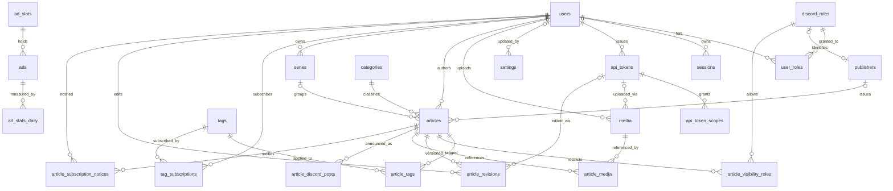
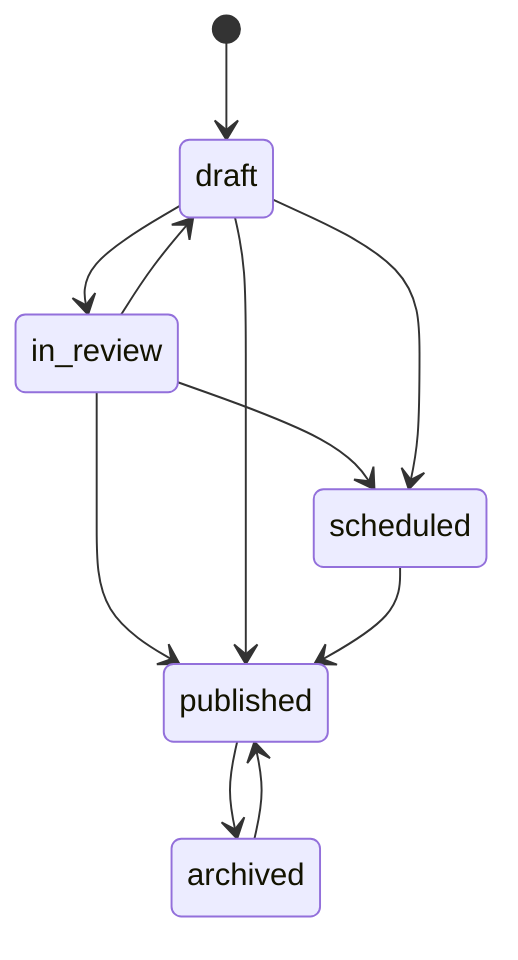
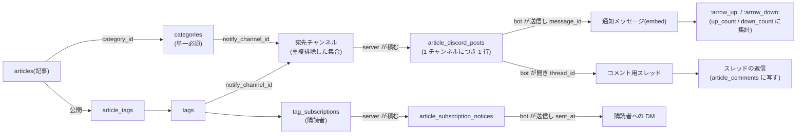

# データモデル(DB スキーマ)設計

本書は instant-news のデータモデルを説明する。実体は `migrations/0001_initial.sql` にあり、本書と当該 SQL は常に一致させる。前提として instant-news は単一コミュニティ構成をとり、1 デプロイが `settings` 表の `discord.guild_id`(初期値は `config.yaml`)で指定する 1 つの Discord サーバー(guild)にのみ対応する。したがってスキーマは guild を跨ぐ列を持たない。

## 設計方針

### Discord への委譲

- 本プラットフォームは、既存の Discord コミュニティが既に持っている仕組みを自前で作り直さないことを一貫した方針とする。コメントは Discord スレッドへ、賛否は絵文字リアクション(`:arrow_up:` / `:arrow_down:`)へ、認証は Discord OAuth2 へ、所属(報道社・閲覧権限)は Discord ロールへ、そして通知の要否は Discord の各人のチャンネル通知設定へ委譲する。いずれも「自前で作った方が良くなる理由が無い」ことが採用の根拠であり、その結果としてスパム対策・パスワード管理・購読管理 UI・投票の受け口のいずれもスキーマに現れない。
- **コメントと投票の写しは持つが、書き込みは受け付けない。**記事面がコメントを読めるようにするには写しが要る一方、書く場所を 2 つにすると Discord 側とサイト側のどちらが真実かが決まらなくなる。`article_comments` は Discord のスレッドの返信の写しであり、書き込みは常に Discord で行われる。
- ユーザーは Discord アカウントで一意に識別し、独自パスワードは保持しない。閲覧権限の判定に用いる guild メンバーシップとロールは、ログイン時に取得して DB にスナップショットする。真実のソースは Discord 側であり、bot がゲートウェイのイベント(ロール・メンバー・オーナーの変更)を購読して即座に写す。イベントは取りこぼしうるため、bot は新しいセッションの確立時と一定の間隔ごとに全件を突き合わせて補正する。都度 Discord API を叩かずに権限判定できるようにするためのキャッシュである。
- bot の照合は guild の全メンバーを洗い替えし、以後は参加・離脱・更新のイベントで追随するため、一度もログインしていないメンバーも `users` に現れる。他人を著者に指定して記事を投稿する際に、その相手が実在の行として必要になるためである。

### ロールのスナップショットの非対称な扱い

- `discord_roles` / `user_roles` のスナップショットは 2 つの用途に使われるが、**両者は正反対に扱う**。この非対称は意図的なものであり、片方に揃えてはならない。
- 署名(`articles.publisher_id`)は**公開の時点で凍結する**。公開時に「著者がその報道社のロールを実際に持っているか」を検証し、以後ロールが変わっても動かさない。著者の現在のロールから報道社を引く実装にすると、記者が移籍した瞬間に過去記事の署名が遡って書き換わる。
- 権限判定(閲覧範囲・API キーの資格)は**要求のたびに現在のスナップショットを参照する**。発行時の資格を凍結してはならない。管理者ロールを外れたユーザーの API キーは、その時点で通らなくなるのが正しい。

### 認証(セッションと API キーの併存)

- 人間の利用者は Discord OAuth2 でログインし、`sessions` にサーバー側セッションを持つ。Cookie にはランダムな不透明トークンを載せ、DB にはその SHA-256 のみを保存する(漏洩時にセッションを直接復元させないため生値は持たない)。`oauth_states` は認可フロー中の CSRF 対策の state と PKCE の code_verifier を短命に保持する。
- **機械クライアントは Discord OAuth2 の経路を通れない**(ブラウザのリダイレクトと人間の同意を前提とするため)。記事の自動投稿やプラットフォーム管理のために、API キー認証(`api_tokens`)が OAuth2 セッションと併存する。
- **API キーは発行者ユーザーに紐づく。**独自アカウントを増やすのではなく、既存ユーザーの権限を機械が借りる形にする。これにより責任の所在が必ず人間に残り、記事の著者も必ず実在のユーザーになる。キーの生値は保持せず SHA-256 のみを保存する(`sessions` と同じ設計を踏襲する)。
- 発行資格(誰が発行できるか)とスコープ(何ができるか)は別の軸として扱う(`api_token_scopes`)。管理者が発行できるスコープを 1 つに束ねてはならない。広告管理アプリに与えるのは `ads:admin` だけであり、記事の署名を偽造する力(`articles:write:any`)を混ぜて渡してはならない。
- `settings:admin` は `admin.role_ids` を書き換えられる、すなわち管理者の資格そのものを配れるため、他のどのスコープよりも強い。実質的に管理者権限の委譲であることを踏まえて渡す。

### 設定

- **設定の真実は `settings` 表にある。**`config.yaml` が持つのは、設定を DB から読むために先に要る値(`server`・`database`)と、実行環境と一体でありコンテナの外で決まる値(画像の保存先。名前付きボリュームのマウント先と一致していなければ意味を成さない)だけであり、それ以外の設定はこの表が持つ。管理者はフロントエンドから変更する。
- `config.yaml` の対応する値は**初回起動時の初期値としてのみ読まれ、以後は参照されない**(未登録のキーだけを埋める)。起動のたびに設定ファイルで上書きすると、フロントエンドから変更した値が次の再起動で黙って元へ戻る。どちらが真実かを一方に決める必要がある。
- **値を JSON で持つのは、設定が整数・文字列・ロール ID の配列と一様でないためである。**型ごとに列を分けても、設定を 1 つ足すたびにスキーマを変える羽目になる。
- **型・既定値・検証・秘密かどうか・変更に再起動を要するかは、コード側の登録簿(`common/settings.py`)が定義し、表は値だけを持つ。**登録簿に無いキーは読み書きしないため、この表に古い行が残っていても無視される。設定を増やす操作がマイグレーションを伴わないのはこのためである。
- `updated_by` は設定を最後に変更した利用者であり、初期値の投入なら NULL である。API キー経由の変更でもキーの発行者を記録するため、設定を変えた責任の所在は必ず人間に残る。詳細は `docs/settings.md` を参照。

### 記事と分類軸

- 記事本文は GitHub Flavored Markdown のソース(`body_md`)を権威とし、表示用 HTML(`body_html`)は再生成可能なキャッシュとして持つ。
- **記事は単一必須のカテゴリ(`articles.category_id`、NOT NULL)を持つ。**「この記事は何欄の記事か」が一意に定まり、通知先の主たる振り分けが多重化しない。カテゴリ集合はデプロイごとに異なるため、コアは固定せず `taxonomy:admin` スコープの管理用 API で編集する。設定ファイルではなく DB に置くのは、`articles.category_id` が外部キーで参照する実体であり、設定ファイルでは参照整合性を保てないためである。
- **カテゴリ以外の分類軸がタグである。**記事は複数のタグを持てる(`article_tags`)。カテゴリが「主分類は 1 つ」を担保し、タグが横断的な軸を担う、という分担にする。
- 連載(`series`)は、順序を持つ記事のまとまりを表す軸として、カテゴリ・タグとは別に併存する。
- `categories.include_in_latest` が 0 のカテゴリはトップの新着一覧に載せない。相場のような定期記事が横断的な流れを埋めるのを防ぐための除外である。
- `articles.byline_mode` が `publisher` なら表示上の署名は報道社名のみになる。`author_id` は保持され続けるため、監査では誰が書いたかを追える。
- `articles.is_sponsored` は記事広告(タイアップ記事)を表し、コアが「広告」表示を描画して消せないようにする。`sponsor_name` は `is_sponsored=1` のとき必須である(「広告」とだけ書いても誰の広告か分からず開示にならない)。
- `articles.is_breaking` は速報を表し、通知時に設定したロールを mention する。乱発を防ぐため、フラグを立てられるロールは `settings` 表の `articles.breaking.allowed_role_ids` で絞る(空なら誰も立てられない)。
- `article_revisions.is_correction` は単なる更新と訂正を区別する。訂正された記事は記事面の冒頭で明示する。
- `article_revisions.via_token_id` は「誰が実際に投稿したか」の監査証跡であり、`editor_id`(「誰の名前で書かれたか」)とは別物である。`articles:write:any` が他人の署名で記事を出せる以上、これが無いと説明責任が崩れる。

### 報道社と署名

- 報道社(`publishers`)は記事を発行する主体であり、所属は Discord のロールで表すため `role_id` で参照する。ロールから導けるのは所属者・名前・色・並び順だけであり、ロゴ・slug・紹介文・立場(`stance`)は導けないためテーブルが要る。ロールを主キーにはせず、参照する形にする。
- **`publishers.role_id` は `ON DELETE SET NULL` であり、`ON DELETE CASCADE` にしてはならない。**Discord でロールを削除すると bot がロールの削除イベントを受けて `discord_roles` の行を消すため、CASCADE では報道社が消滅し、その報道社の過去記事の署名が全て失われる。解散した報道社の過去記事は署名を保ったまま残るのが正しい。
- `stance` は立場を表し、`state`(国営メディア等)なら記事面にラベルを添える。

### 通知

- **新着記事の通知先は、記事のカテゴリ(`categories.notify_channel_id`)とタグ(`tags.notify_channel_id`)を重複排除した集合として解決する。**カテゴリは単一必須であるため必ず 1 件の供給源になり、タグは追加の宛先を足す。1 チャンネルにつき 1 通だけ送る。
- **宛先が 0 件の記事はどこにも通知しない。既定チャンネルへのフォールバックは持たない。**宛先 0 件は事故ではなく「このカテゴリ・このタグでは通知しない」という設定の結果である。フォールバックを設けると、その意図を表現する手段が失われる。
- **通知の要否は Discord 側の各人のチャンネル通知設定に委ねる。**チャンネルへの投稿を通知として受け取るかどうかは Discord が既にミュート・通知レベルとして提供しており、それより良いものを自前で作る理由がない。したがって投稿ごとに通知の要否を指定するフラグは持たない。読み手は購読したいチャンネルだけを通知有りにすればよい。
- タグの購読(`tag_subscriptions`)は、チャンネル単位のプッシュに対する個人単位のプッシュである。チャンネルを持たない小さなタグに対しても成立するため、両者は排他ではない。

### 通知の待ち行列(アウトボックス)

- **`article_discord_posts` は通知の対応表であると同時に、送信の待ち行列(アウトボックス)を兼ねる。**server は公開時に宛先を解決して `message_id = NULL` の行を積むだけで、実際の送信は bot が行い `message_id` を埋める。
- **この方式を採る理由は、server から bot へ直接イベントを送る方式では bot が落ちている間のイベントを取りこぼすためである。**DB を待ち行列にすれば、bot は復帰後に未送信の行を拾って送れる。公開の判断は server が行い、bot は送信のみを担う(bot が停止していても公開は進み、待ち行列に積まれる)。
- `article_subscription_notices` も同じアウトボックス方式で、server が公開時に購読者の行を積み、bot が DM を送って `sent_at` を埋める。宛先チャンネルを持たない記事でも購読者への DM は成立するため、この待ち行列は `article_discord_posts` とは独立に積む。
- `article_discord_posts.up_count` / `down_count` は通知メッセージに付いた `:arrow_up:` / `:arrow_down:` の数であり、それ以外の絵文字は数えない。bot が投票を促すために自分で付けた 1 件は除く。bot はリアクションのイベントを受けて実際の数を数え直して上書きし、取りこぼした行は照合が同じ経路で補正する。
- **賛否は個数として符号なしで持ち、差し引きは列にしない。**読者へ見せる点数は `up_count - down_count` で負になりうる一方、符号なし同士の引き算は MySQL では値が丸まるのではなく文そのものが失敗する。読み出し側が `SUM()` を経た値どうしで引くか、Python 側で引く。
- **コメント数は列に持たない。**`article_comments` の行数が唯一の真実である。数を別に持つと、記事面に並ぶコメントの数と食い違いうる。
- `article_comments` は Discord スレッドの返信の写しである。`author_discord_user_id` に `users` への外部キーを張らない。コメントの主は guild のメンバーとは限らず(他の bot・webhook・退会した利用者)、外部キーにすると、写せない投稿が 1 件現れた瞬間にそのコメント欄全体が欠ける。表示名は `users` を LEFT JOIN して解決し、見つからなければ Discord のユーザー ID だけを見せる。
- 本文の取得には Discord の `message_content`(特権 intent)が要る。

### 画像

- 受け取ったバイト列をそのまま保存せず、デコードして WebP に再エンコードしたものだけを保存する。これによりポリグロットファイル(画像としても別形式としても解釈されるファイル)が破壊され、EXIF が落ち、配信時の Content-Type を自分で決められる。
- 実体はファイルシステム上に内容アドレスで置き(`{hash[0:2]}/{hash[2:4]}/{hash}.{variant}.webp`)、`media.content_hash` は**変換後 WebP(原寸版)の SHA-256** である(変換前の原本のハッシュではない。配信するものとハッシュを一致させる)。
- 公開・非公開は配信時の判断であり保存は分けない。同じバイト列が公開のカバーにも本文中の画像にもなりうるため、保存を分けると実体が二重化する。
- **`article_media` の行を消してはならない**(本文の保存時に追記のみ行う)。編集で本文から画像を外しても、過去の改版はその画像を参照し続けており、削除すると改版履歴を開いた瞬間に画像が 404 になる。

### 広告

- **コアは広告の配信と計測のみを担い、管理は外部アプリケーションに委ねる。**広告主・掲載プラン・課金・管理 UI はコアの担当ではない。コアが提供するのは、枠(`ad_slots`)・クリエイティブ(`ads`)・重み付き抽選による配信・日次実績(`ad_stats_daily`)、および外部アプリが `ads:admin` スコープの API キーで接続する口だけである。この分担を明示しないと、管理画面がなし崩しにコアへ流れ込む。
- 掲載期間(`starts_at` / `ends_at`)の判定はコアが行う。外部の管理アプリ側にスケジューラを要求しないためである。
- `ad_slots` が推奨寸法を持つのは、外部の管理アプリが入稿前に見え方を自前で再現できるようにするためである(コアはプレビュー用エンドポイントを持たない)。
- 実績はイベント 1 行ずつではなく日次で加算する(`INSERT ... ON DUPLICATE KEY UPDATE`)。イベント単位で記録すると表示のたびに行が増える。秒単位の分析が要ると分かった時点で足せばよい。

### 共通

- Discord のスノーフレーク ID は符号なし 64bit に収まるため `BIGINT UNSIGNED` で保持する。文字コードは絵文字・多言語のため `utf8mb4` に統一する。
- 日本語を含む全文検索のため、`articles` の `title` と `body_md` に ngram パーサの FULLTEXT インデックスを張る。
- **ngram パーサに対しては MySQL のストップワードを無効にする**(`docker-compose.yml` の `--innodb-ft-enable-stopword=OFF`)。既定のストップワード一覧は英語向けで 1 文字の "a" と "i" を含み、ngram パーサは語ではなくトークンを構成する「文字」を一覧と照合して、1 文字でも該当するとそのトークンごと索引から捨てる。有効のままでは、2 文字トークンが全て a か i を含む語(`Japan` → ja/ap/pa/an、`data` → da/at/ta、`Asia`・`AI`・`API`・`capital` など)は索引に 1 つも残らず、検索しても常に 0 件になる。`ch` が残る `China` や a も i も含まない `Tokyo` は引けるため、不具合は語ごとにまだらに現れる(日本語の語は影響を受けない)。この値は索引の構築時に読まれ、検索時の値は結果を左右しないため、既存のデータベースで変える場合は FULLTEXT インデックスの作り直しが要る。

## エンティティ関連

`categories.notify_channel_id` と `tags.notify_channel_id` は Discord のチャンネル スノーフレークであり、DB 内に参照先の実体を持たないため外部キーではない(上図にも現れない)。

上図の `|o`(0 または 1)は NULL 許容の外部キーを表す。`articles.publisher_id`(報道社に属さない個人の記事)・`articles.series_id`(連載に属さない記事)・`publishers.role_id`(解散して所属ロールを失った報道社)・`media.via_token_id` と `article_revisions.via_token_id`(Web UI からの操作)・`settings.updated_by`(初期値の投入のまま変更されていない設定)がこれにあたる。`articles.category_id` だけは NOT NULL であるため `||`(必ず 1)である。

## テーブル一覧

| テーブル | 役割 |
| --- | --- |
| users | Discord アカウントに紐づく執筆者・閲覧者。guild メンバーシップとオーナーか否か(`is_guild_owner`)を持つ。 |
| discord_roles | 対象 guild のロール一覧のキャッシュ。閲覧制限の選択肢・表示名の解決に加え、`permissions`(権限ビットフィールド)で Administrator を判定する。 |
| user_roles | ユーザーが保有する guild ロールのスナップショット(ログイン時に洗い替え、以後はメンバーの更新イベントで追随。照合で補正)。 |
| sessions | サーバー側セッション。トークンは SHA-256 ハッシュで保存し生値は持たない。 |
| oauth_states | OAuth2 認可フロー中の一時状態(CSRF 対策の state と PKCE の code_verifier)。 |
| settings | プラットフォームの設定の真実。値を JSON で持ち、型・検証・秘密かどうかはコード側の登録簿(`common/settings.py`)が定義する。`config.yaml` の対応する値は初回起動時の初期値としてのみ読まれる。 |
| api_tokens | 機械クライアントの API キー。発行者ユーザーに紐づき、生値は保持せず SHA-256 のみを保存する。 |
| api_token_scopes | キーに与えたスコープ(`articles:write` / `articles:write:any` / `ads:admin` / `taxonomy:admin` / `settings:admin`)。 |
| media | 取り込んだ画像の登録簿。実体は内容アドレスでファイルシステムに置き、行は寸法・バイト数・公開可否・取り込み元を持つ。 |
| publishers | 記事を発行する報道社。所属は Discord ロール(`role_id`)で表し、ロゴ・slug・紹介文・立場(`stance`)を持つ。 |
| categories | 記事の主分類。記事は単一のカテゴリを必ず持つ。`notify_channel_id` がこの欄の主チャンネルを、`include_in_latest` が新着一覧への掲載可否を決める。 |
| tags | 主分類以外の分類軸。記事は複数のタグを持てる。`notify_channel_id` を設定したタグは追加の宛先になる。 |
| tag_subscriptions | タグの購読。購読したタグの記事が公開されると bot が DM を送る(個人単位のプッシュ)。 |
| series | 連載(マガジン)。順序を持つ記事のまとまり。 |
| articles | 記事本体。状態・閲覧範囲・カテゴリ・報道社・連載への所属・本文(Markdown ソースと HTML キャッシュ)を持つ。タグ付けは `article_tags` が持つ。 |
| article_tags | 記事とタグの多対多。 |
| article_visibility_roles | 閲覧範囲が restricted の記事について、閲覧を許可するロールの集合。 |
| article_revisions | 記事の改版履歴。編集ごとのスナップショットに加え、訂正か否か(`is_correction`)と実際の投稿経路(`via_token_id`)を持つ。 |
| article_media | 記事が参照する画像。画像配信の権限判定に使う。追記のみで削除しない。 |
| article_discord_posts | 記事公開時の通知の宛先・通知メッセージ・スレッド・賛否(`up_count` / `down_count`)の対応。送信の待ち行列を兼ねる。宛先チャンネルごとに 1 行を持つ。 |
| article_comments | 記事のコメント(Discord スレッドの返信)の写し。本文・投稿者・賛否を持つ。書き込みは受け付けない。 |
| article_subscription_notices | タグ購読者への DM の待ち行列。 |
| ad_slots | 広告枠。フロントエンドが slug で参照し、推奨寸法を入稿側へ伝える。 |
| ads | 配信する画像広告。掲載期間・重み・有効フラグを持つ。 |
| ad_stats_daily | 広告の日次実績(表示回数・クリック数)。 |

## 記事の状態遷移(status)

`draft`(下書き)→ `in_review`(レビュー中)→ `scheduled`(予約公開)→ `published`(公開)→ `archived`(アーカイブ)を表す。予約公開は `scheduled_at` に公開予定時刻を持ち、時刻到来時に `published` へ遷移して bot が通知する。誰が公開できるか(下書き止まりか公開可能か)は Discord ロールに基づきアプリケーション層で判定する。

## 閲覧範囲(visibility)

記事ごとに閲覧できる相手を Discord ロールに基づいて 3 段階で制御する。判定はログイン中ユーザーの `user_roles` スナップショットに対して行い、権限判定は要求のたびに現在のスナップショットを参照する。

| 値 | 閲覧できる相手 |
| --- | --- |
| public | 未ログインを含む誰でも。 |
| members | 対象 guild に参加しているログイン済みユーザーのみ(`users.is_guild_member`)。 |
| restricted | `article_visibility_roles` に列挙したロールのいずれかを持つユーザーのみ。 |

報道社は Discord ロールであるため、その報道社ロールを `article_visibility_roles` に指定すれば社内限定記事が成立する。

### 画像の閲覧範囲

画像は記事本文とは別の URL(`/media/{hash}/{variant}.webp`)で配信されるため、閲覧範囲の判定も画像側で独立に行う必要がある。判定は `media.is_public` で二分される。

| 対象 | `media.is_public` | 配信時の判定 |
| --- | --- | --- |
| カバー画像・広告・報道社ロゴ・タグアイコン | 1 | 認証なしで誰にでも配信する。 |
| 本文中の画像 | 0 | `article_media` からこの画像を参照する記事を引き、そのいずれか 1 つでも当該主体が閲覧できるなら配信する。参照できるものが無ければ 404。 |

**閲覧制限のある記事(`members` / `restricted`)であっても、カバー画像は公開である。**これは意図的な取引であり、黙って放置してよい性質のものではない。Discord のクローラは embed を生成する際にセッションを持たないため、認証を要求するとカバーが embed に出ない。embed に画像を出すために、カバーだけは URL を知る者に見える状態を受け入れている。

したがって、**機密性のある記事のカバーに、中身が分かる画像を選んではならない。**一方で漏れるのはカバー 1 枚に限定される。本文中の画像は `article_media` を介して本文と同じ判定を受けるため、認証で守られる。「ログイン済みなら本文中の画像も配信する」という簡略化をしてはならない(`restricted` 記事の図版が全メンバーへ漏れる)。

なお、`article_media` の行を削除しないことは権限判定にも効いている。参照が消えると、その画像を参照する記事が存在しないことになり、配信が 404 になる。

## Discord との対応関係

記事の公開は次の対応関係を生む。コメントと投票を Discord 側に委譲することで、投稿の受け口・スパム対策・投票機能を自前で実装しない(読むための写しだけを持つ)。

### 通知先チャンネルの振り分け

通知先は記事のカテゴリとタグが決める。公開時、記事のカテゴリの `notify_channel_id` と、記事に付いた各タグの `notify_channel_id` を集めて重複を除いた集合を宛先とし、1 チャンネルにつき 1 通だけ送る。カテゴリは単一必須であるため必ず 1 件の供給源になり(未設定なら 0 件)、タグは追加の宛先を足す。`notify_channel_id` が未設定のカテゴリ・タグは振り分けに関与しない。

**宛先が 0 件になった記事はどこにも通知しない。**既定チャンネルへのフォールバックは持たない。宛先 0 件は「通知先を取り違えた事故」ではなく、「このカテゴリ・このタグでは通知しない」という設定の結果として扱う。フォールバックを設けると、その意図を表現する手段が失われる。

宛先が複数になった記事は複数チャンネルへ通知される。このとき `article_discord_posts` は当該記事について複数行を持ち、通知ごとに独立したスレッドと賛否(`up_count` / `down_count`)を保持する。記事としての賛否は当該記事の全行の合計として求め、コメント数は `article_comments` の当該記事の行数として求める(コメントはどのスレッドに付いたものも、同じ記事のコメントとして扱う)。二重送信は `article_discord_posts` の `(article_id, channel_id)` の一意制約が防ぐ。

1 記事が複数のチャンネルへ流れること自体は問題としない。それを通知として受け取るかどうかは、Discord の各人のチャンネル通知設定が決める。コメント・投票・認証・所属を Discord へ委譲してきたのと同じく、通知の要否も Discord のチャンネル通知設定へ委譲する。したがって投稿ごとに通知の要否を指定するフラグは持たない。

### タグ購読者への DM

`tag_subscriptions` に登録したユーザーは、そのタグが付いた記事の公開時に bot から DM を受け取る。宛先チャンネルを持たないタグに対しても購読は成立するため、`article_subscription_notices` の待ち行列は `article_discord_posts` とは独立に積む。主キー `(article_id, user_id)` が、チャンネルへの通知における `(article_id, channel_id)` と同じく二重送信を防ぐ。著者自身は購読していても DM の対象から外す(自分の記事の公開を自分へ通知する意味がない)。

### 待ち行列としての振る舞い

`article_discord_posts` と `article_subscription_notices` は、いずれも server と bot の間の待ち行列である。

| 状態 | `article_discord_posts` | `article_subscription_notices` |
| --- | --- | --- |
| 未送信(bot が拾う対象) | `message_id IS NULL` | `sent_at IS NULL` |
| 送信済み | `message_id IS NOT NULL` | `sent_at IS NOT NULL` |

server は公開時に宛先を解決して未送信の行を積むところまでを行い、送信はしない。bot は未送信の行を定期的に拾って送信し、`message_id` / `posted_at` / `sent_at` を埋める。送信に失敗した行は未送信のまま残り、次の周回で再試行される。DM が拒否されている場合は、無限に再試行しないよう `sent_at` を埋める。

この分担により、bot が停止していても記事の公開は進み、通知は待ち行列に積まれたまま bot の復帰を待つ。server から bot へ直接イベントを送る方式では、bot が落ちている間のイベントを取りこぼす。
