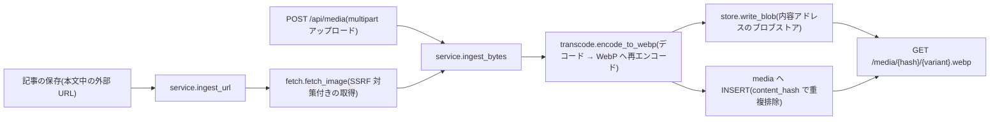
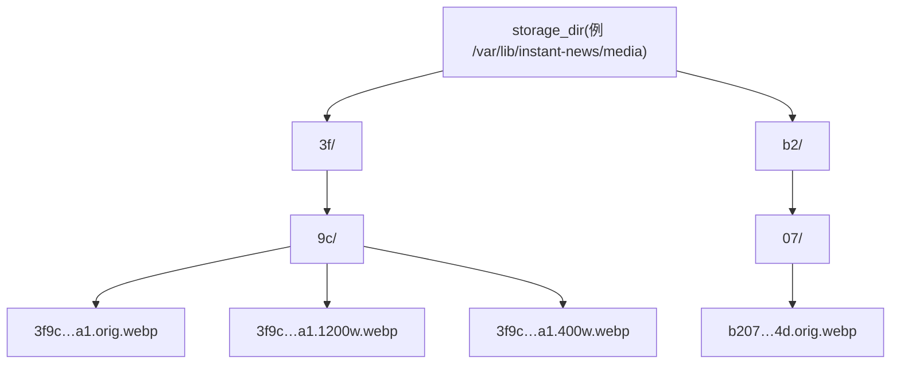
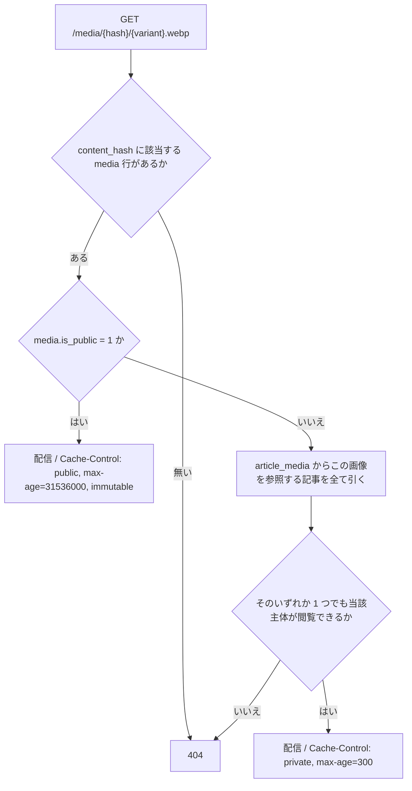
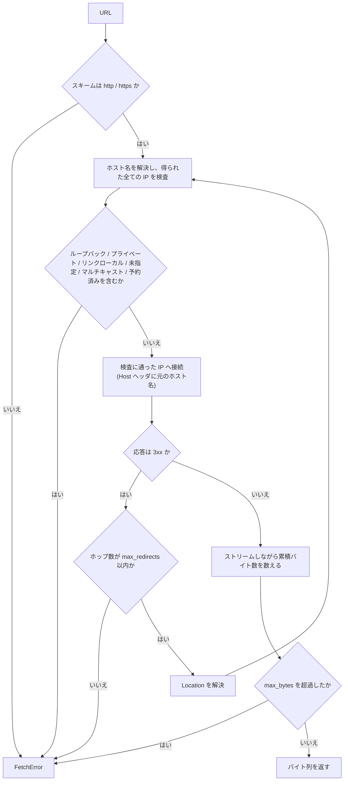

# 画像(取り込み・保存・配信)

本書は instant-news における画像の取り込み・保存・配信を説明する。実装は `server/app/media/`(`store.py` / `fetch.py` / `transcode.py` / `service.py`)と `server/app/routers/media.py`、権限判定は `server/app/visibility.py` の `can_view_media` にある。保存の実体は `migrations/0001_initial.sql` の `media` / `article_media` である。本書とこれらは常に一致させる。

設定の出どころは 2 つに分かれる。画像の保存先(`media.storage_dir`)は `config.yaml` が持ち、取り込みの各上限(`media.fetch.*` / `media.max_pixels` / `media.quota_bytes_per_user`)は `settings` 表が持つ。前者は名前付きボリュームのマウント先と一体であり、後者は管理者が `/admin` の画面から変更する。本書が挙げる既定値は初期値(`config.example.yaml`)のものであり、稼働中の値は `settings` 表にある。出どころが違うことを画像の各モジュールへ持ち込まないため、呼び出し側が `common/config.py` の `effective_media_config()` で 1 つの `MediaConfig` へ畳んでから渡す。詳細は [docs/settings.md](settings.md) を参照。

## 全体像

画像がプラットフォームへ入る経路は 2 つ、出る経路は 1 つである。

- アップロードは `POST /api/media` で受ける。クエリは `is_public` と `lossless` の 2 つである。`is_public`(既定 false)は認証なしで配信してよいかを指定する(カバー・広告・報道社ロゴ・タグアイコンは公開、本文中の画像は非公開)。`lossless`(既定 false)は可逆で符号化するかを指定し、ロゴ・タグアイコンなどの線画に使う(`encode_to_webp(..., lossless=True)` へ渡り `media.is_lossless` に残る)。
- 記事本文中の外部 URL は、記事の保存のたびにサーバーが取得して取り込み、本文の URL を自前の配信 URL へ差し替える。
- 配信は `GET /media/{hash}/{variant}.webp` の 1 つだけである。

## 取り込みは保存時に行う(公開時ではない)

- **画像の取り込みは記事の保存のたびに行い、公開時まで待たない。**Discord の CDN URL は約 24 時間で失効するため、公開時に取得する設計では、下書きのまま放置された記事は失効後の取得になって必ず失敗する。書き手が画像を貼った時点が、その URL が最も確実に生きている時点である。
- **取得は同期的に行う。**保存の応答を返す前に取り込みを終える。非同期のバックグラウンド処理にすると、取り込みが完了する前に公開された記事が一時的に元 URL を指す状態が生まれ、その中間状態を追跡する仕組みが要る。状態管理が増える割に得るものが少ない。
- 同期的に行う以上、保存の応答時間が外部ホストの応答時間に引きずられる。したがって上限を 2 つ設ける。1 記事あたりの取得件数(`media.fetch.max_images_per_article`、既定 20)と、1 記事の保存あたりの取得の総所要時間(`media.fetch.total_timeout_seconds`、既定 60 秒)である。件数の超過分と締切の超過分は取得せず、失敗として扱う。
- 既に `/media/` を指している URL は取り込みの対象から外す(再保存のたびに自分の画像を取得し直さない)。

## 取得に失敗した画像は元の URL のまま残し、執筆者に伝える

- **1 枚の取得に失敗しても保存そのものを失敗させない。**外部ホストの一時的な不調でその日の記事が出せなくなるのは、防ぎたい害(リンクが朽ちること)より大きい。失敗した URL は本文中で元のまま残し、記事は保存できる。
- **ただし黙って残してはならない。**元 URL のまま残ったことを書き手が知らなければ、朽ちるリンクが気付かれないまま公開され、24 時間後に画像の消えた記事が残る。`POST /api/articles` と `PATCH /api/articles/{id}` の応答は、失敗した URL と理由を `media_failures` として必ず返す(`service.IngestFailure`)。
- この 2 つは対で意味を持つ。投稿を失敗させないことは、失敗を伝えることとセットで初めて正当化される。

## 形式は WebP に一本化する

- **受け取ったバイト列をそのまま保存しない。必ずデコードし、再エンコードした WebP だけを保存する。**これは単一で最も効く安全対策である。
- 有効な画像であり同時に有効な HTML/JS でもあるポリグロットファイルは、デコード → 再エンコードを通ると画素だけが残って破壊される。EXIF(撮影位置を含む)も同時に落ちる。配信時の `Content-Type` を受け取った値ではなく自分で決められるようになる。SVG は画像ではなく script を含められる XML であるが、ラスタライズを経れば無害な画素になる。
- WebP を選ぶ理由は次のとおりである。

| 要件 | WebP が満たす理由 |
| --- | --- |
| 透過の保持 | 非可逆でも透過を保持できる。ロゴ・国旗・アイコンは透過が前提であり、透過を持てない形式では背景が箱になる。 |
| 可逆の選択 | 可逆も選べる。スクリーンショットや図表は線と数字が主であり、非可逆のリンギングが最も目立つ題材である。 |
| アニメーション | アニメーションを保持できる。動く GIF を静止画に落とさずに済む。 |
| 容量 | 同等画質で JPEG より小さい。 |

- 符号化の既定は非可逆(品質 90)。ロゴ・タグアイコンなどの線画は可逆(`encode_to_webp(..., lossless=True)`、`media.is_lossless`)。動く GIF はアニメーション WebP(`media.is_animated`)。

## 保存

### 内容アドレスのブロブストア 1 つ

- 実体はブロブストア 1 つに内容アドレスで置く。パスの形は `{media.storage_dir}/{hash[0:2]}/{hash[2:4]}/{hash}.{variant}.webp` である(`store.blob_path`)。

- **公開・非公開で保存を分けない。**公開か否かは配信時の判断であり、保存を分ける理由にならない。同じバイト列が公開のカバーにも本文中の画像にもなりうるため、分ければ同一の実体が二重化する。
- **2 階層に切るのは 1 ディレクトリへのファイル集中を避けるためである。**先頭 2 バイト分を 2 段に分けることで、SHA-256 の一様性がそのままディレクトリの分散になる。
- **クライアントが送ってきたファイル名を保存先の決定に一切使わない。**保存先はハッシュだけから決まるため、`../../etc/passwd` のような名前を送っても保存先の計算に入らない。パストラバーサルが原理的に効かない(名前を無害化して防ぐのではなく、名前を使わない)。配信側の `{hash}` も 16 進 64 桁として検証してから使う。
- **同じ画像は何度取り込んでも実体が 1 つになる。**`media.content_hash` は `UNIQUE` であり、`ingest_bytes` は変換後に既存行を引いて、あればそれを返す(重複排除)。10 人が同じ画像を貼っても保存されるバイト列は 1 つである。

### hash は変換後の WebP のもの

- **`media.content_hash` は変換後の原寸 WebP バイト列の SHA-256 であり、変換前の原本のハッシュではない。**内容アドレスが指すべきは配信するものである。原本のハッシュにすると、URL が指す名前と実際に返るバイト列が食い違い、内容アドレスの性質(内容が変われば URL も変わる)が成り立たなくなる。永久キャッシュの正当性はこの一致に依存している。

### Docker の名前付きボリュームに置く

- **`media.storage_dir` には Docker の名前付きボリュームを割り当てる。**コンテナのファイルシステムに置くと、イメージを入れ替えた瞬間に全画像が消える。デプロイのたびに過去記事の画像が消えるのは、事故ではなく設計の帰結として起きる。

## 配信

### URL の形は 1 つ

- 配信 URL は `GET /media/{hash}/{variant}.webp` のみである(`service.media_url`)。
- **URL に記事を含める案(`/articles/{slug}/media/...` の形)は採らない。**理由は 2 つある。第一に、同じ画像は重複排除により複数の記事から参照されうるため、記事を含めた URL は一意にならない。第二に、`body_html` はレンダリング結果のキャッシュであり、そこへ焼き込まれた URL は記事の移動・改名(slug の変更)で壊れる。内容アドレスの URL は記事の都合から独立しており、どちらの問題も起きない。

### 判定はサーバー側で行う

- **URL の形で権限を表現しない。**推測しにくい URL は権限ではない。判定は毎回サーバー側で行う。

- **参照の検査は省略できない。**これを省いて「ログイン済みなら配信」にすると、記事側の閲覧範囲の判定が画像に効かなくなる。`restricted` 記事の図版が全メンバーへ漏れ、閲覧制限は本文のテキストにしか掛からないことになる。図版が本文より機微でないという理由は無い。
- **「いずれか 1 つでも閲覧できれば配信」で正しい。**その記事を読める以上、そこに載っている画像も読めてよい。同じ画像が `public` な記事と `restricted` な記事の両方から参照されている場合、それは公開記事に載っている画像であり、既に公開されている。
- 未認証の主体でも、`is_public = 0` の画像が公開記事から参照されていれば配信される。公開記事の本文画像を読者が見られなければ記事が成立しない。
- 変種のファイルが無い場合は `orig` へフォールバックする(アニメーションは `orig` しか持たない)。

### キャッシュ制御

| 対象 | ヘッダ | 根拠 |
| --- | --- | --- |
| `is_public = 1` | `Cache-Control: public, max-age=31536000, immutable` | 内容アドレスなので内容が変われば URL も変わる。同じ URL が別のバイト列を返すことがないため、永久キャッシュが安全に成立する。 |
| `is_public = 0` | `Cache-Control: private, max-age=300` | 同じ URL が主体によって配信にも 404 にもなる応答であり、共有キャッシュに載せてはならない。 |

- **`is_public = 0` の応答に `public` を付けてはならない。**共有キャッシュ(CDN・プロキシ)に載った瞬間、判定を通っていない者へ同じバイト列が配られる。サーバー側の判定を正しく書いても、1 語のヘッダで無効化される。

### 404 と 403

- **参照権限が無い場合は 403 ではなく 404 を返す。**403 は「そこに何かがある」ことを教えてしまう。存在しないハッシュと、閲覧できないハッシュは、応答上で区別できてはならない。記事の詳細取得(`GET /api/articles/{slug}`)が閲覧不可のときに 404 を返すのと同じ規則である。

### 配信時のヘッダ

- `Content-Type: image/webp`(受け取った値ではなく、自分で再エンコードした事実から決まる)。
- `X-Content-Type-Options: nosniff` と `Content-Security-Policy: default-src 'none'; sandbox` を必ず付ける。再エンコードによってポリグロットは既に破壊されているが、万一 HTML として解釈されても何も実行できない状態にしておく。

## 保存時の取り込みは SSRF である

**任意の URL をサーバーに取得させる機能は SSRF そのものである。**この配置では対策は任意ではなく必須である。server は Docker 上で MySQL と同一ネットワークに居り、`http://db:3306` は実際に到達可能である。取り込み方式では攻撃者は記事に画像を貼るだけでよく、自分では到達できない宛先をサーバーに踏ませられる。`fetch.fetch_image` は以下を全て満たす。1 つでも欠ければ対策として成立しない。

- **スキームは `http` / `https` のみ。**それ以外(`file:` / `gopher:` / `data:` など)は `FetchError`。
- **名前解決して得られた全ての IP を検査する。**ループバック(`127.0.0.0/8`, `::1`)、プライベート(`10/8`, `172.16/12`, `192.168/16`, `fc00::/7`)、リンクローカル(`169.254.0.0/16`, `fe80::/10`)、未指定(`0.0.0.0/8`, `::`)、マルチキャスト、予約済みを拒否する。判定は `ipaddress` モジュールの `is_private` / `is_loopback` / `is_link_local` / `is_reserved` / `is_multicast` / `is_unspecified` に委ね、自前の文字列比較で書かない。
- **`169.254.169.254` はクラウドのメタデータ取得口である。**リンクローカルを拒否することでこれも塞がる。ここへ到達されると、そのインスタンスに割り当てられた資格情報がそのまま漏れる。
- **検査した IP に対して接続する(IP を固定する)。**名前解決と接続が別々に名前を引くと、その間に DNS の応答を差し替えられる(DNS リバインディング)。検査したのは公開 IP、接続したのは内部 IP、という擦り抜けが成立する。検査に通った IP をそのまま接続先とし、`Host` ヘッダに元のホスト名を入れる。https では SNI と証明書検証が元のホスト名に対して働くよう、アドレス解決を固定した transport を `httpx.AsyncClient` に渡す。
- **リダイレクトを自動で追ってはならない(`follow_redirects=False`)。各ホップの `Location` を自前で解決し、ホップごとに IP を再検査する。**公開 URL から内部宛先への 302 は、SSRF の最も素直な回避手段である。最初の 1 回だけ検査する実装は、これを一切防げない。`media.fetch.max_redirects`(既定 3)を超えたら `FetchError`。
- **`Content-Length` を信用しない。**送信側が申告する値であり、小さく申告して大量に送れる。ストリームしながら累積バイト数を数え、`media.fetch.max_bytes`(既定 10 MiB)の超過で中断する。
- `media.fetch.timeout_seconds`(既定 10 秒)を 1 枚あたりのタイムアウトとする。

## その他の防御

- **展開爆弾。**数 KB の PNG が展開時に数十 GB の画素になる圧縮爆弾に対し、**バイト数ではなく画素数で上限を設ける**(`media.max_pixels`、既定 5000 万画素)。`max_bytes` は転送量にしか効かず、この攻撃はそこを通り抜ける。`Image.MAX_IMAGE_PIXELS` を設定し、デコード前に画素数を検査して超過は `TranscodeError` とする。
- **取り込み方式では攻撃者が URL を指定するだけで踏ませられる。**アップロードと違い、攻撃者は自分の帯域を使わず、外部ホストに置いた 1 つのファイルで何度でも踏ませられる。上限の設定はアップロード経路よりむしろ取り込み経路のために要る。
- **ユーザー単位の利用量の上限。**`media.quota_bytes_per_user`(既定 1 GiB)を `media.byte_size` の `uploaded_by` 合計で検査し、超過は例外とする。既存の実体を重複排除で再利用した場合は加算しない(実際に増えていないため)。

## 変種(サイズ)の生成

- 変種は `orig` / `1200w` / `400w` の 3 つ(`store.VARIANTS`)。記事面と og:image は原寸、一覧・カード・サムネイル・報道社のロゴ・タグのアイコンは 400w を引く。画面側の読み替えは `web/js/api.js` の `mediaVariant` が担い、`/media/{hash}/{変種}.webp` の形に当たる URL だけを書き換える(カバー・ロゴ・アイコンは自由書式の列であり、取り込みを経ない外部ホストの URL がそのまま入りうるため)。詳しくは [docs/frontend.md](frontend.md) を参照。
- **原寸より広い変種は生成しない。**拡大は情報を増やさず容量だけ増える。600px の画像に対しては `orig` と `400w` だけが存在し、`1200w` の要求は `orig` へフォールバックする。
- アニメーション WebP は `orig` のみを持つ。
- 内容アドレスであるため、変種は同じハッシュの下に並列に置ける(`{hash}.orig.webp` / `{hash}.1200w.webp` / `{hash}.400w.webp`)。変種を増やす判断が保存先の構造に影響しない。

## 自動削除は行わない

- **参照されなくなった画像を消す素朴な GC は誤りである。**`article_revisions` は過去の `body_md` を保持しており、現在の本文から外した画像も過去の版は参照し続けている。現在の本文だけを見て「参照されていない」と判定して消すと、改版履歴を開いた瞬間に画像が壊れる。同じ理由により、**`article_media` の行も消さない**(本文の保存時に追記のみ行う)。
- したがってコアは自動削除の経路を持たない。参照が切れたように見える画像も残す。ディスクは、記事の履歴が壊れることに比べれば安い。
- 削除は管理者による明示的な取り下げ(権利侵害の申し立て、誤って取り込んだ機密画像など)に限る。`article_media.media_id` の外部キーが `ON DELETE RESTRICT` であるため、参照の残る `media` 行は単純には消えない。これは摩擦ではなく、削除が意図的な操作であることを DB 側で担保する仕組みである。
- **重複排除している以上、1 つの実体を消すとそれを参照する全記事から消える。**取り下げの前に、その画像を参照する記事を `article_media` で必ず確認する。1 記事のために消したつもりが 10 記事から消える。

## og:image

- **カバー画像は `og:image` に出す。**カバーは `is_public = 1` として認証のない場所に置く方針であり、技術的な障害は無い。
- **本文中の画像は `og:image` に使えない。**`is_public = 0` であり認証を挟むため、セッションを持たないクローラは取得できない。
- `og:image` と本文の抜粋を出すのは `visibility='public'` かつ `status='published'` の記事に限る(`pages.render_article_page`)。それ以外はタイトルも含めて出さない。

## 残る権限の穴(意図的なもの)

- **カバー画像を認証のない場所に置く以上、閲覧制限のある記事(`members` / `restricted`)のカバーも、URL を知る者なら誰でも見られる。**これは穴として認識したうえで受け入れている取引であり、忘れてよい性質のものではない。
- 取引の中身はこうである。Discord のクローラは embed を生成する際にセッションを持たない。カバーに認証を要求すれば、embed に画像が出ない。embed に画像を出すために、カバー 1 枚だけは公開を受け入れている。
- 実際にその URL が露出するのは、ロール制限チャンネルへ投稿された embed のみである。そのチャンネルを見られる者は、そもそもその記事を読める者とほぼ一致するため、実用上のリスクは低い。
- **それでも、機密性のある記事のカバーに中身が分かる画像を選んではならない。**閲覧制限は本文には効いているが、カバーには効いていない。この性質は執筆者に伝える必要がある(伝えられていない前提は、守られていない前提と同じである)。
- 漏れるのはカバー 1 枚に限られる。本文中の画像は `article_media` を介して本文と同じ判定を受けるため、認証で守られる。

## 運用への影響

- **画像を持つことで、状態を持つ場所が MySQL だけではなくなる。**画像ボリュームが 2 つ目の状態を持つ場所として加わる。
- **DB だけを復旧しても記事は復元されない。**`media` の行は残っていても実体が無ければ、記事の画像は全て壊れる。逆に画像だけあっても、それがどの記事のものかは DB にしかない。
- **バックアップは DB と画像ボリュームの両者を、整合した時点で取る必要がある。**片方だけの復旧、あるいは異なる時点の組み合わせでの復旧は、`media` に行があるのに実体が無い(または実体があるのに行が無い)状態を生む。前者は記事の画像が 404 になり、後者は参照されない実体がディスクに残る。
