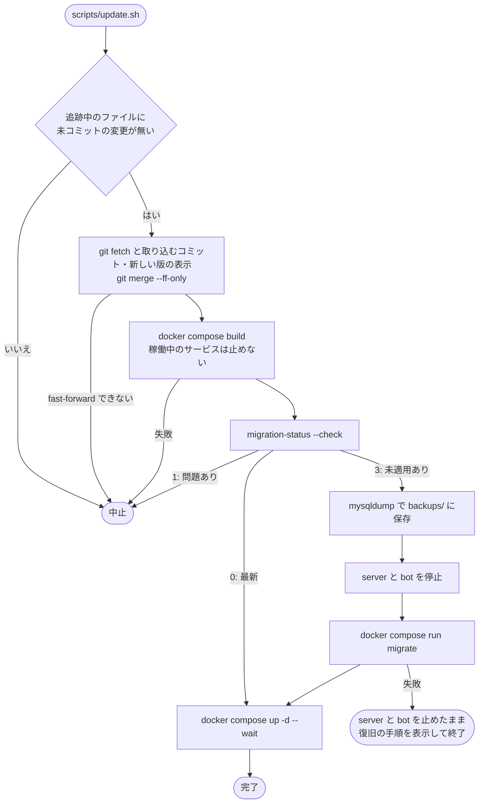

# スキーマのマイグレーションと更新の取り込み

本書は、DB スキーマを作り・変える仕組みと、デプロイへコードの更新を取り込む手順を説明する。実装は `common/migrations.py`(探索・適用・履歴・起動時のチェック)、`server/cli.py` の `migrate` / `migration-status` / `resolve-migration`、`docker-compose.yml` の `migrate` サービス、`scripts/update.sh` と `scripts/restore-db.sh` にある。本書とこれらは常に一致させる。

## マイグレーションのファイル

- スキーマは `migrations/` の SQL を版の番号順に適用した結果である。空の DB も既存の DB も同じ経路で作られ、MySQL の初期化スクリプト(`/docker-entrypoint-initdb.d`)は使わない。
- ファイル名は `NNNN_<名前>.sql` とする。`NNNN` は 0001 から欠番も重複もなく続く 4 桁の版の番号、名前は英小文字・数字・`_` からなる。規則に合わないファイル、欠番、重複があると、適用も起動も拒否される。
- **前進専用である。**適用済みのファイルは書き換えず、スキーマの変更は常に次の番号の新しいファイルとして追加する。取り消しの SQL(down)は持たず、戻すときはバックアップから戻す。
- 1 ファイルに複数の文を書ける。ファイル全体を 1 度に MySQL へ送り、文の区切りは MySQL 自身のパーサが決めるため、コメントや文字列の中の `;` もそのまま書ける。`DELIMITER` は MySQL クライアントのコマンドであり、使えない。
- MySQL の DDL は暗黙にコミットされるため、1 つの版を不可分には適用できない。複数の文からなる版は、途中で失敗すると前半だけが残る。DDL とデータの書き換えを混ぜる場合は、途中で止まっても手で完了させやすい順に並べる。
- server と bot は起動時にスキーマがコードと一致することを確かめるため、スキーマを変える版は、それを前提とするコードと同じコミットで追加する。

## 履歴表

適用の記録は `schema_migrations` 表が持つ。この表はマイグレーションのファイルではなく、ランナー自身が最初の適用の前に作る。

| 列 | 内容 |
| --- | --- |
| `version` | 版の番号。主キー。 |
| `name` | ファイル名の名前部分。 |
| `checksum` | 改行を LF に揃えたファイルの内容の SHA-256。CRLF でチェックアウトしても変更とはみなさない。 |
| `started_at` | 適用を始めた時刻。 |
| `finished_at` | 適用を終えた時刻。`NULL` は、適用を始めたまま完了していない(未完了、dirty)ことを表す。 |

版を適用するときは、まず `finished_at` を `NULL` にした行を書き、ファイルを実行し、成功してから `finished_at` を埋める。失敗してもプロセスが落ちても未完了の行が残るため、途中で止まった版は必ず見つかる。

同時に 2 つのランナーが動かないよう、適用と未完了の解消は DB ごとの `GET_LOCK` を保持して行う。ロックを 60 秒待っても得られなければ、何もせずに失敗する。

## 状態と、適用・起動を拒否する条件

`migration-status` は版ごとに次のいずれかを表示する。

| 状態 | 意味 |
| --- | --- |
| 適用済み | 完了しており、ファイルの内容も適用時と同じ。 |
| 未適用 | コードにあり、DB にはまだ記録がない。 |
| 未完了 | 適用を始めたまま完了していない。 |
| 適用後に変更あり | 完了しているが、ファイルの名前か内容が適用時から変わっている。 |
| コードに無い版 | DB には記録があるが、コードはその版を持たない(DB がコードより新しい)。 |

未適用の版があるだけなら問題ではなく、`migrate` で適用する。次のいずれかに当たる場合は、`migrate` は 1 つも適用せずに失敗し、server と bot も起動しない。

- 未完了の版がある。
- 適用後に変更された版がある。
- コードに無い版が DB にある。
- 未適用の版の番号が、適用済みの版より小さい。番号を振り直したか、履歴表を手で書き換えた場合に起きる。
- 履歴表が無いのに表がある。マイグレーションの仕組みより前に作られた DB であり、引き継ぐ手段はない。DB を空にして作り直す。

## 起動時のチェック

server(`server/main.py` の lifespan)と bot(`bot/main.py`)は、DB に接続した直後、設定を読むより前に `ensure_current` を呼ぶ。コードの持つ版がすべて完了しており、上の問題が 1 つも無いときに限り起動を続ける。それ以外では理由と取るべき操作を出力して起動を中止する。古いスキーマに新しいコードが、あるいは新しいスキーマに古いコードが接続したまま動くことはない。

## CLI

いずれも `config.yaml` の `database` 節だけを読み、DB に専用の接続を 1 本開く。compose 環境では `docker compose run --rm migrate python -m server.cli <コマンド>` で実行する(`migrate` だけは `docker compose run --rm migrate` で足りる)。

| コマンド | 動作 |
| --- | --- |
| `migrate` | 未適用の版を順に適用し、適用した版を表示する。 |
| `migration-status [--check]` | 版ごとの状態と問題を表示する。`--check` を付けると終了コードで状態を返す。0 は最新、3 は未適用の版がある、1 は適用を拒否する問題がある。 |
| `resolve-migration <版> retry` | 未完了の版の記録を消す。次の `migrate` がその版を最初から適用し直す。 |
| `resolve-migration <版> applied` | 未完了の版を、現在のファイルの内容で適用済みとして記録する。 |

## compose での位置づけ

`docker-compose.yml` の `migrate` は server と同じイメージで `python -m server.cli migrate` を 1 回実行して終わるサービスである。db が healthy になってから動き、server と bot は `migrate` が正常終了するまで起動しない。`docker compose up` のたびに実行され、未適用の版が無ければ何も変えない。

テスト用の `docker-compose.test.yml` も同じ形の `migrate` サービスで空の DB を作るため、統合テストは毎回、本番と同じランナーで全版を適用した DB に対して走る。

## 更新の取り込み(scripts/update.sh)

デプロイのチェックアウトで `scripts/update.sh` を実行すると、次の流れでコードとマイグレーションを取り込む。`--no-pull` を付けると取得の段を飛ばし、チェックアウトをそのままデプロイする。

- ビルドは、サービスを止める前に行う。ビルドが失敗しても、稼働中のサービスには影響しない。
- 未適用の版があるときだけ、DB をバックアップし、server と bot を止めてから適用する。古いコードが動いたまま DDL を当てないためである。バックアップは `backups/<UTC 時刻>-<更新前のコミット>.sql.gz` に、所有者だけが読める権限で保存する。設定表の資格情報を含むため、Git にもイメージにも入らない(`.gitignore` / `.dockerignore`)。
- 画像の実体(`media-data`)はマイグレーションで変わらないため、バックアップは DB だけである。ボリューム全体のバックアップは `docker-compose.yml` の冒頭に従い、別に行う。
- 手作業で行う場合も順序は同じである。`git pull` の後に `docker compose up -d --build` を実行すれば `migrate` が先に動くが、この場合はバックアップも、旧コードの停止も行われない。

## 失敗したとき

`migrate` が失敗すると、エラーには何文目で失敗したか、それまでに何文が完了したか、MySQL のエラーが示される。update.sh は server と bot を止めたまま、バックアップの場所と更新前のコミットを表示して終了する。

- **バックアップへ戻す。**`scripts/restore-db.sh <バックアップ>` は server と bot を止め、DB を削除してからダンプを読み込む。失敗した版が作った表もこれで消え、履歴表もバックアップ時点に戻る。そのうえで `git checkout <更新前のコミット>` と `docker compose up -d --build` で、コードも元に戻す。
- **その場で直す。**`migration-status` で未完了の版を確かめ、DB を調べる。残りの文を手で実行して版を完了させたなら `resolve-migration <版> applied`、前半の変更を手で取り消して版を最初から適用できる状態に戻したなら `resolve-migration <版> retry` を実行し、`docker compose up -d` で起動する。版のファイル自体に誤りがあった場合は、未完了のうちに限りファイルを直してよい。`applied` は直した後のファイルの内容を記録する。
