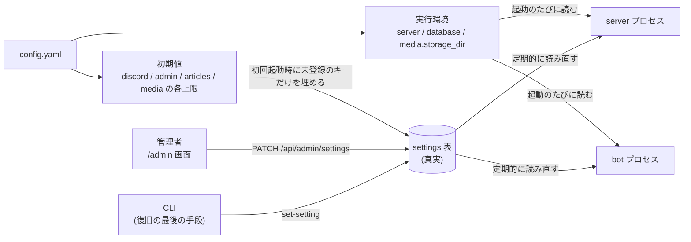

# 設定

本書はプラットフォームの設定の所在・変更方法・反映の時機を説明する。設定の**真実は MySQL の `settings` 表**にあり、管理者はフロントエンドの `/admin` から変更する。`config.yaml` は実行環境の 3 つの値を除き、初回起動時に `settings` 表へ写す初期値でしかない。

型・既定値・検証・秘密かどうか・変更に再起動を要するかは、コード側の登録簿(`common/settings.py` の `REGISTRY`)が定義する。`settings` 表は値だけを持ち、登録簿に無いキーは読み書きしない。設定を増やすときは登録簿に足すだけでよく、表の変更も画面の変更も要らない(画面は `GET /api/admin/settings` の応答から動的に生成する)。

## config.yaml と settings 表の役割分担

`config.yaml` が**常に真実であり続けるのは `server`・`database`・`media.storage_dir` の 3 つだけ**である。

- `server` と `database` は、設定を DB から読むために先に要る。DB へ繋ぐ前に DB の設定は読めない。ただし `server.base_url`(外部から到達可能な公開 URL)だけは理由が異なり、DB 接続のためではなく、公開 URL がどこにあるかが実行環境そのものであるために `config.yaml` が持つ(後述の「認可の戻り先は設定ではない」も参照)。
- `media.storage_dir` は名前付きボリュームのマウント先と一体であり、コンテナの外で決まる。マウントを変えずにこの値だけを変えても画像は見つからず、変えた瞬間に既存の全画像が参照できなくなる。画面から触らせる意味がない値である。

それ以外(`discord` / `admin` / `articles` / `media` の各上限)は `settings` 表が持ち、`config.yaml` の対応する値は初回起動時の初期値としてのみ読まれる。**初期値の節は任意である**(後述)。書かれていないキーは登録簿の既定値で埋まる。



## 初期値は初回だけ

server と bot は、どちらも DB 接続の直後に初期値の投入を行う。`INSERT IGNORE` であり冪等であるため、どちらが先に起動しても、両方が呼んでも安全である。bot も呼ぶ必要があるのは、bot が先に起動したときに `settings` 表が空だと bot は自分のトークンすら読めないためである。投入したキーがあれば起動ログに出る。

**起動のたびに `config.yaml` で DB を上書きしてはならない。**画面から変更した値が次の再起動で黙って元へ戻り、「設定したはずの値が効いていない」という最も原因を追いにくい状態になる。設定ファイルと DB のどちらが真実かは一方に決める必要があり、ここでは DB を真実とする。したがって **2 回目以降の起動で `config.yaml` のこれらの値を書き換えても何も起きない。**

この方式の帰結として、設定を増やした場合は**新しいキーだけが投入される**。既にある行は触らないため、既存の設定は初期値で塗り潰されない。

## 初期値の節は任意である

**初期値の節は書かなくてよい。**書かれていないキーは登録簿の既定値で埋まる。投入が済んだ後に `config.yaml` から初期値の節を削除しても、`settings` 表に値がある以上は何も起きない。「以後は参照されない」という説明が、そのまま実際の挙動である。

任意にしているのは 2 つの理由による。

- 初期値の節が必須だと、**登録簿に設定を 1 つ足すたびに、既存のデプロイが `config.yaml` を編集するまで起動しなくなる。**設定を増やすだけの変更が、稼働中の全デプロイの設定ファイルの更新を要求するのは筋が悪い。
- 投入が済んだ後の `config.yaml` にそれらのキーが残っている必要はない。必須にすると「初回起動時の初期値でしかない」という説明と実際の挙動が食い違い、削除してよいのか判断できなくなる。

**既定値を持てない設定だけは、初回起動時に `config.yaml` で与える必要がある。**`discord.guild_id` と OAuth・bot の資格情報がこれにあたる(下表の既定値が「必須」のもの)。guild の ID や資格情報のように、その環境でしか決まらない値に妥当な既定は存在しない。足りない場合は、どのキーが足りないのかを挙げて起動時に落ちる。

**CLI は `config.yaml` に `database` 節しか求めない。**復旧の最後の手段が、復旧しに来た対象そのものの健全さを前提にしてはならないためである。

## 設定の一覧

型(`kind`)は登録簿が定める。画面の入力欄も、値の検証も、この型から決まる。

| 型 | 意味 |
| --- | --- |
| id | Discord のスノーフレーク ID。JSON では**必ず文字列**(JavaScript の `Number` は 2^53 までしか正確に表せず、スノーフレークは黙って壊れる)。 |
| id_list | ID の配列。JSON では文字列の配列。空の配列は有効な値である。重複は保存時に落とす。 |
| int | 整数。`true` / `false` は整数として受け付けない。 |
| number | 数値(小数を含む)。 |
| str | 空にできない文字列。 |
| secret | 空にできない文字列。API は生値を返さない。 |

`id` と `id_list` の設定には、その ID がどの実体を指すかを表す**参照先(`ref`)**が付くことがある。現在の唯一の値は `role`(Discord のロール)であり、`admin.role_ids` と速報の 2 つのロール設定が該当する。参照先を持つ設定を、画面は ID の直接入力ではなくロールの選択(名前・色・Discord の並び順)として出す。`GET /api/admin/settings` がこの `ref` を各項目に載せるため、画面はキー名を見て分岐しない(分岐させると、後から別の実体を指す `id_list` を足したときに、その欄までロールの選択肢が並ぶ)。参照先の実体を DB に持つものだけを `ref` で表せる。通知先チャンネル(`categories.notify_channel_id` / `tags.notify_channel_id`)は `settings` 表ではなく専用の表が持つ値であり、かつチャンネルのスナップショットを持たないため選択肢を示せず、ID の直接入力である。

全 19 キーを次に挙げる。既定値が「必須」のものは、その環境でしか決まらないため既定を持てず、初回起動時に `config.yaml` で与える必要がある。値域を外れる値は画面・API・CLI のいずれからも保存できない。画面の入力欄は、この表の**値域**を `GET /api/admin/settings` の応答(各項目の `minimum` / `exclusive_minimum` / `maximum`)から受け取って制約に反映する。値域を画面側へ書き写さないのは、書き写した分だけこの表・登録簿・画面の三者が食い違い、その食い違いが「保存を押して初めて 400 で上限を知る」形で現れるためである。

| キー | 型 | 既定値 | 値域 | 変更可否 | 再起動の要否 | 説明 |
| --- | --- | --- | --- | --- | --- | --- |
| discord.guild_id | id | 必須 | — | 不可 | 不要 | このデプロイが対応する唯一の guild。画面には表示するが変更できない(理由は後述)。 |
| discord.oauth.client_id | str | 必須 | — | 可 | 不要 | 利用者認証に使う Discord アプリケーションの ID。 |
| discord.oauth.client_secret | secret | 必須 | — | 可 | 不要 | 利用者認証に使う Discord アプリケーションのシークレット。設定済みかどうかだけを表示し、生値は返さない。 |
| discord.bot.token | secret | 必須 | — | 可 | **要** | 新着記事を通知する bot の資格情報。bot は起動時にのみ読むため、変更を反映するには bot の再起動が要る。 |
| discord.bot.publish_poll_interval_seconds | int | 15 | 1〜3600 | 可 | 不要 | 公開された記事の通知の待ち行列を bot が確認する間隔(秒)。server が予約公開の時刻到来を確かめる間隔でもある。**この 2 つだけは Discord のイベントで駆動できない**(公開を決めるのは server であり、Discord は記事が公開されたことを知らない)。 |
| discord.bot.guild_reconcile_interval_seconds | int | 3600 | 1〜3600 | 可 | 不要 | guild のロール・メンバー・オーナーを Discord と突き合わせて補正する間隔(秒)。**ロールの変更はこの間隔を待たずにイベントで即座に反映されるため、これは反映の速さを決める設定ではない。**イベントを取りこぼした場合にそれが正される時刻の上限である。**上限があるのは安全のためである**(後述)。 |
| discord.bot.count_reconcile_interval_seconds | int | 3600 | 1〜86400 | 可 | 不要 | 通知メッセージとコメントに付いた投票の数、およびコメントそのものを Discord と突き合わせて補正する間隔(秒)。投票もコメントもイベントで即座に反映されるため、これは取りこぼしが正される時刻の上限である。 |
| discord.bot.count_reconcile_window_days | int | 14 | 0〜365 | 可 | 不要 | 投票の数とコメントを照合し直す、公開からの日数。照合は対象期間の通知とスレッドを 1 件残らず読み直すため、際限なく遡ると、反応がとうに止んだ記事まで含めて問い合わせが増え続ける。**この範囲を過ぎた通知にもイベントは届き、投票もコメントもそのまま更新される**(イベントが読むのは実際に変化した投稿だけであるため、打ち切る必要がない)。**スレッドを開けなかった・投票用の絵文字を付けられなかった通知を bot が拾い直す期間も兼ねる**ため、0 にするとその再試行も止まる。 |
| admin.role_ids | id_list | 空 | — | 可 | 不要 | プラットフォーム管理の資格を与えるロール。空でも、Discord の Administrator 権限を持つロールの保有者と guild オーナーは管理者として扱われる。Administrator を配らずに管理を委譲する手段。**誤ると自分を締め出しうる**(復旧は CLI から)。 |
| articles.breaking.allowed_role_ids | id_list | 空 | — | 可 | 不要 | 記事に速報フラグを立てられるロール。空なら誰も立てられない。乱発を防ぐために絞る。 |
| articles.breaking.mention_role_ids | id_list | 空 | — | 可 | 不要 | 速報の通知時に mention するロール。空なら mention しない。 |
| articles.api_rate_limit_per_hour | int | 60 | 0 以上 | 可 | 不要 | API キー 1 本あたりの記事の作成・更新の上限(1 時間あたり)。0 は「このキーでは 1 本も書かせない」という有効な設定。 |
| media.fetch.max_images_per_article | int | 20 | 0 以上 | 可 | 不要 | 記事の保存時に取得を試みる本文中の画像の最大数。超過分は元の URL のまま残る。0 なら取り込まない。 |
| media.fetch.max_bytes | int | 10485760 | 1 以上 | 可 | 不要 | 画像 1 枚あたりの取得を打ち切るバイト数。`Content-Length` は信用せず、ストリームしながら超過で中断する。 |
| media.fetch.timeout_seconds | number | 10 | 0 より大きい | 可 | 不要 | 画像 1 枚の取得に費やす上限(秒)。0 は許さない。取り込まないことを表すなら `media.fetch.max_images_per_article` を 0 にするのが正しく、0 秒にすると全件が「0 秒以内に取得できませんでした」という原因の分かりにくい失敗になる。 |
| media.fetch.total_timeout_seconds | number | 60 | 0 より大きい | 可 | 不要 | 記事の保存 1 回で画像の取得に費やす総時間の上限(秒)。超過したものは失敗として扱い、元の URL のまま残す。0 を許さない理由は 1 枚あたりのタイムアウトと同じ。 |
| media.fetch.max_redirects | int | 3 | 0〜10 | 可 | 不要 | 画像の取得で追うリダイレクトの上限。各ホップで宛先 IP を検査する。0 ならリダイレクトを追わない。 |
| media.max_pixels | int | 50000000 | 1 以上 | 可 | 不要 | デコード後の画素数の上限。展開爆弾(数 KB の画像が展開時に数十 GB の画素になる)への対策はバイト数では効かず、画素数で縛る必要がある。 |
| media.quota_bytes_per_user | int | 1073741824 | 0 以上 | 可 | 不要 | 1 人が取り込める画像の合計バイト数の上限。 |

## ロールの照合の間隔に上限がある理由

`discord.bot.guild_reconcile_interval_seconds` の上限(3600 秒)は、利便性ではなく安全のための制約である。

このプラットフォームは「権限を凍結せず、要求のたびに現在のロールから判定する」という方針を採る。管理者を外れた利用者の API キーがその時点で通らなくなり、**ロールを外すという最も自然な対処がそのまま権限の剥奪になる**ためである。しかしこの「現在のロール」の実体は `user_roles`・`users.is_guild_member`・`users.is_guild_owner`・`discord_roles.permissions` のスナップショットであり、**それを書くのは bot だけである。**

bot は 2 つの経路でこれを書く。常態では、Discord のゲートウェイのイベント(ロールの作成・更新・削除、メンバーの参加・離脱・更新、オーナーの移譲)を受けて即座に写す。ロールを外した瞬間にスナップショットが追随するため、**この間隔は剥奪が効くまでの待ち時間ではない。**

もう 1 つが照合であり、これが上限を必要とする理由そのものである。ゲートウェイのイベントは取りこぼしうる。bot が停止している間の変更は届かず、リスナの処理が失敗した場合(DB の瞬断など)も discord.py はその例外を握り潰して次へ進み、Discord はそのイベントを再送しない。取りこぼしてもゲートウェイの接続が生きている限り新しいセッションは張られないため、放置すれば **bot を再起動するまで、剥奪したはずのロールがスナップショットに残り続ける。**照合は guild の現在の状態を丸ごと突き合わせてこれを正す。

したがって上限が無ければ、設定を変更できる者がこの間隔を極端に長く設定することで、取りこぼしが永久に正されない状態を作れてしまう。上限は、判定に使うスナップショットが古びうる時間そのものの上限である。イベントが届いている限りスナップショットはほぼ遅延なく追随し、届かなかった場合でもこの上限までに必ず正される。

なお bot は、この間隔を待たずに照合すべき場面を自分で知っている。ゲートウェイの新しいセッションを確立したとき(その間のイベントは失われている。回線が切れただけで同じセッションを再開できた場合は、取りこぼしたイベントを Discord が再送するため補正は要らない)、guild が利用可能に戻ったとき、そしてイベントの処理が例外で失敗したときには、間隔の途中でも直ちに照合する。

## discord.guild_id は変更できない

`discord.guild_id` は `settings` 表が持つが、登録簿で `editable=False` としてあり、画面からも API からも変更できない(`PATCH /api/admin/settings` は 400 で明示的に断る)。

変更すると、ロールのスナップショット・報道社のロール紐付け・閲覧範囲の判定がすべて別の guild を指すことになり、既存のデータが無意味になる。記事の署名も閲覧制限も、対象 guild のロール ID を前提に保存されているためである。**他の guild へ移すのは再デプロイであって設定変更ではない。**

## 認可の戻り先は設定ではない

Discord OAuth2 の認可後に戻る URL(`redirect_uri`)は、`settings` 表にも `config.yaml` にも無い。`server.base_url` と、戻り先を受け取る経路 `/auth/callback` から導出する(`server/app/auth.py` の `oauth_redirect_uri`)。**この導出結果を Discord のアプリケーション設定の Redirects へ登録すること。**登録が無い、または食い違う場合、Discord は認可画面の時点で断る。

設定として持たないのは、**入りうる正当な値が 1 つしかない**ためである。戻り先の経路を決めているのは `server/app/routers/auth.py` の `callback` であり、オリジンは `base_url` そのものである。他の値を入れて意味のある場面が存在しない。

にもかかわらず設定にすると、`base_url` と食い違った値を保存できてしまう。そのとき壊れるのは**ログインだけ**である。記事の閲覧も画像の配信も正常に見えるため、原因が認証の設定にあることが分かりにくく、Discord 側の登録・こちらの設定・`base_url` の 3 つを突き合わせて初めて食い違いが見える。導出にすれば、この不整合は構造的に起こり得なくなる。

`redirect_uri` は認可の開始(認可 URL)とコードの交換(トークン要求)の両方に現れ、**Discord は 2 つが完全に一致することを求める。**導出の関数を 1 つに限ることで、片方だけが違う値になる余地も無くしている。同じ理由で `/auth/callback` の経路も `server/app/auth.py` の `OAUTH_CALLBACK_PATH` が唯一の定義であり、ルーターはそれをそのまま経路の宣言に使う。認可で申告する戻り先と、実際にそれを受け取る経路が食い違うことはない。

## 秘密の設定を API から返さない

`secret` の設定(`discord.oauth.client_secret` と `discord.bot.token`)は、`GET /api/admin/settings` が生値を返さない。返した時点で、画面を開ける者すべてに bot のトークンが渡ることになるためである。応答に含まれるのは `value: null` と、設定済みかどうかを表す `is_set` だけである。

したがって画面は現在値を表示できない。**空欄のままの送信は「変更しない」を意味する。**`PATCH /api/admin/settings` は本体に含まれたキーだけを更新するため、秘密を変えないことは「そのキーを送らない」ことで表現する(空文字を送って秘密を消してしまわないための設計でもある)。

## 反映の時機

server と bot は別のプロセスであり、**一方が変更した設定を他方へ伝える経路は DB しかない。**両者は `settings` 表を定期的に読み直す。読み直しの間隔(`common/settings.py` の `CACHE_TTL_SECONDS`。現在は 10 秒)が、そのまま伝播の遅れになる。

- 変更した本人のプロセスには**即座に反映される**(変更時に自プロセスの保持していた値を捨てるため)。
- もう一方のプロセスは `CACHE_TTL_SECONDS` 以内に追いつく。
- bot と server の各ループは周回のたびに、bot のイベントのリスナはイベントを処理するたびに設定を読み直すため、**間隔・window・mention ロールの変更は再起動なしで効く。**ただし間隔の変更が効くのは次の周回からであり、長い間隔を短くしたときは現在の周回が終わるまで待つことになる。
- **`discord.bot.token` だけは起動時にしか読めないため、bot の再起動が要る。**登録簿で `restart_required=True` としてあり、画面もその旨を示す。

## settings:admin は最も強いスコープである

`settings:admin` は `GET|PATCH /api/admin/settings` に必要なスコープであり、管理者のみが発行できる(API キーの権限は要求のたびに現在のロールから判定するため、発行後に管理者でなくなったキーはその時点で通らなくなる)。

**このスコープは `admin.role_ids` を書き換えられる。すなわち管理者の資格そのものを配れる。**`ads:admin` が広告を、`taxonomy:admin` が分類を触れるのとは質が違い、実質的に管理者権限の委譲である。他のどのスコープよりも強いことを踏まえて渡すこと。

なお `updated_by` には、セッション経由・API キー経由のどちらでも `principal.user_id` を記録する。キーは発行者に紐づくため、設定を変えた責任の所在は必ず人間に残る。

## CLI による復旧

`admin.role_ids` を誤って設定して画面から締め出された場合、**CLI が唯一の復旧手段である。**画面からの復旧はできない(管理者でなければ設定を触れず、設定を触れなければ管理者に戻れない)。

```
python -m server.cli list-settings
python -m server.cli get-setting <key>
python -m server.cli set-setting <key> <json-value>
```

CLI が `config.yaml` から読むのは `database` 節だけである。締め出しは初期値の節が古いままでも起こりうるため(初期値はもはや誰も読まないのだから、古くなるのが普通である)、CLI を `config.yaml` 全体の妥当性に依存させると、復旧手段そのものが失われる。

値は JSON として解釈する。配列・数値は JSON で渡す必要がある。

```
python -m server.cli set-setting admin.role_ids '["111111111111111111","222222222222222222"]'
python -m server.cli set-setting articles.api_rate_limit_per_hour 60
python -m server.cli set-setting discord.oauth.client_id '"000000000000000000"'
```

- `get-setting` は**秘密の設定でも生値を出す**(秘密である旨を注記する)。API と扱いが違うのは、CLI は DB へ到達できる者しか実行できず、これが復旧の最後の手段であるためである。DB へ到達できる者は `settings` 表を直接読めるのだから、CLI に伏せさせても守るものがない。
- `set-setting` は `editable=False` のキー(`discord.guild_id`)も**変更できる**。強い警告を出す。締め出したいのは画面の利用者であって、DB の管理者ではない。**これは再デプロイ相当の操作を行う唯一の正規手段である**(前掲のとおり、guild を移すと既存のデータは無意味になる)。
- 値は画面・API と同じ検証を通る。登録簿に無いキーは受け付けない。
